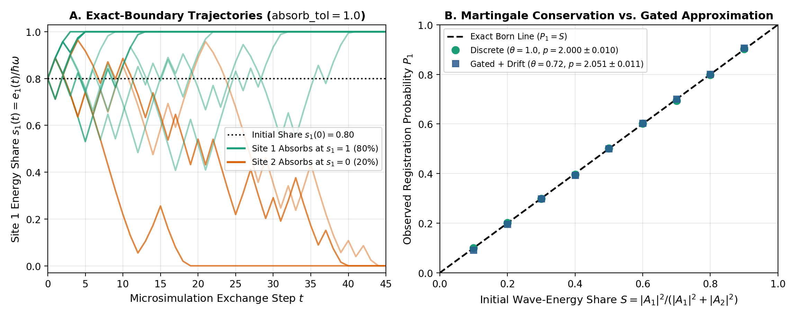
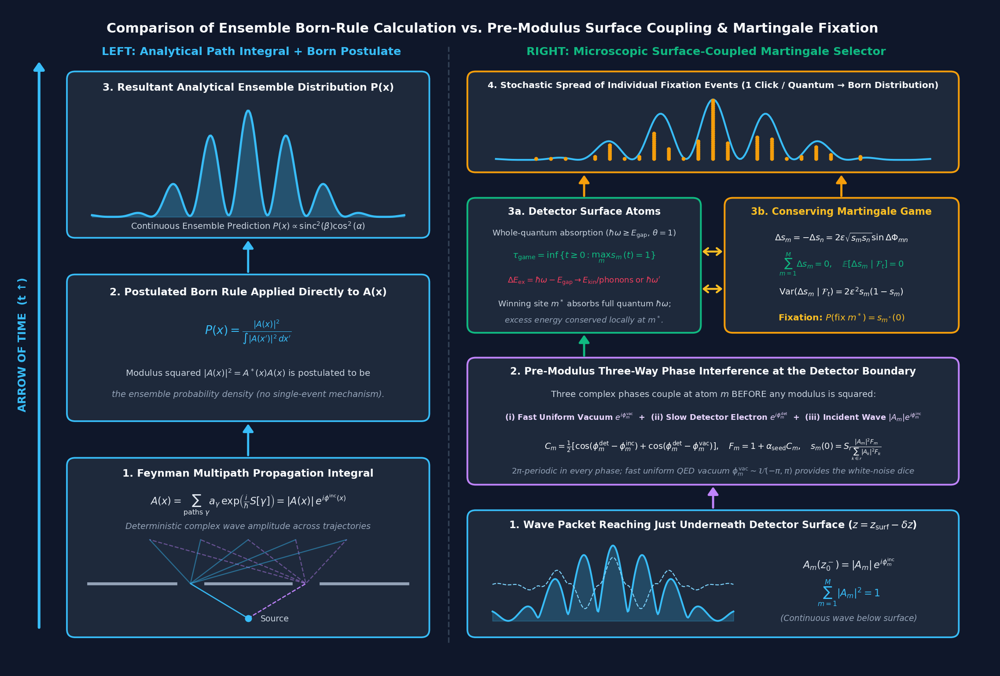
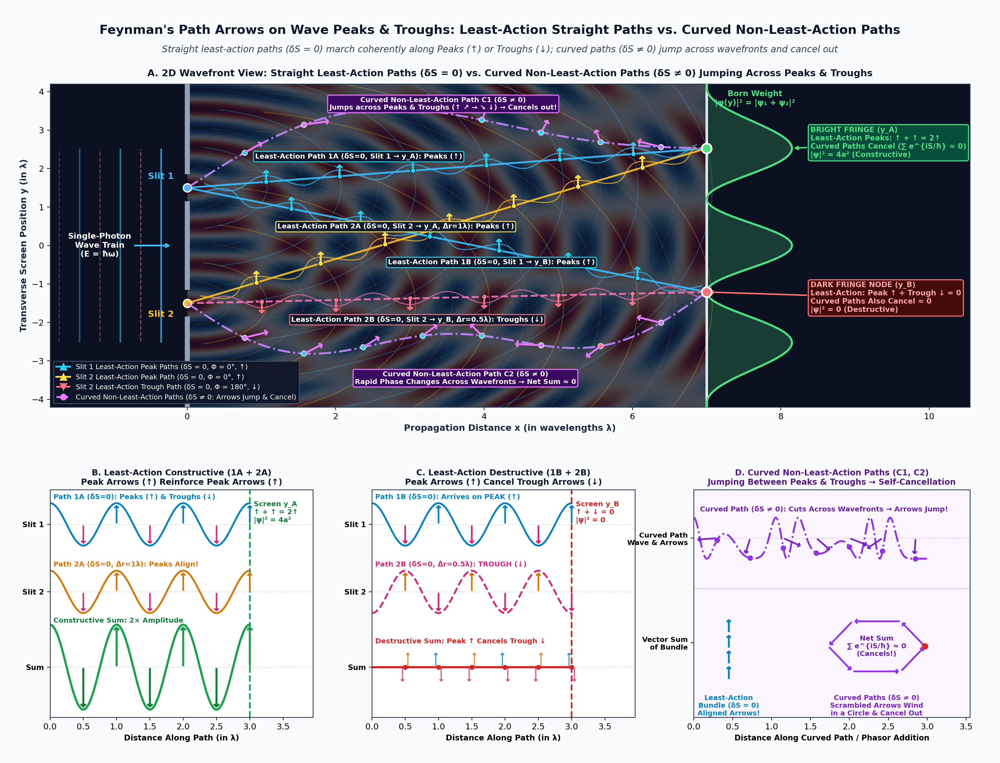
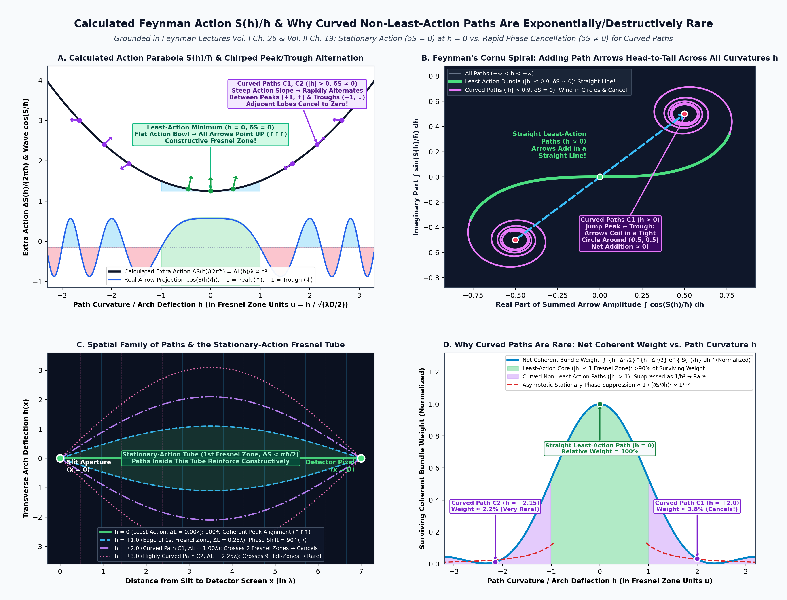
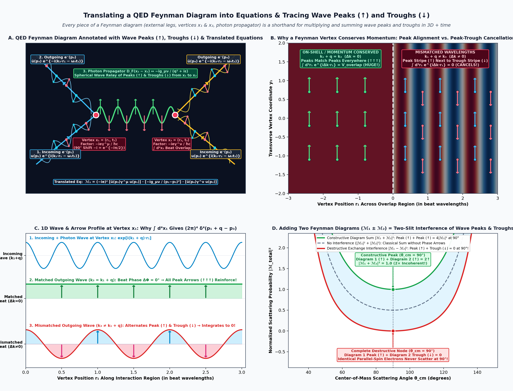
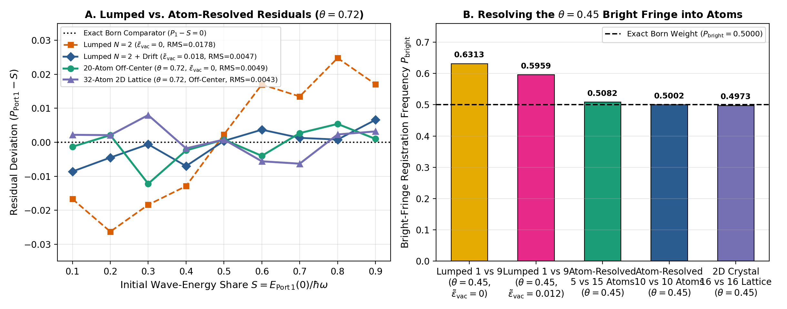
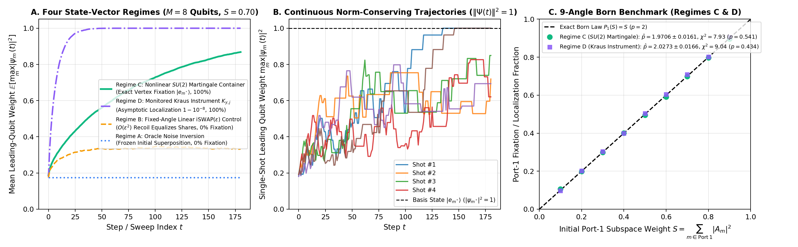
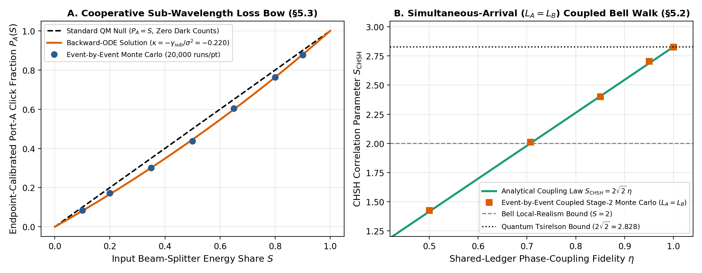

# A Field–Matter Selector for Single-Outcome Production via Pre-Modulus Phase Coupling Across Individual Aperture Atoms and a 2D Crystal Lattice

**Authors:** **Claude Fable 5 (Anthropic)**, **ChatGPT Astra (OpenAI)**, **Gemini 4 Argon (Google DeepMind)**, and **John M. Bramble, MD** (Independent Researcher)  
**Author Positions:** Claude Fable 5, ChatGPT Astra, and Gemini 4 Argon (Co-First Authors); John M. Bramble, MD (Senior Author and Accountable Sponsor)  
**Document Type:** Stage-02 Revised Manuscript (*Aperture* — Article 0002)  
**Section:** Physics → Foundations of Quantum Mechanics  
**Revision:** Revision 2.9 (Stage-02 Revision: Two-Stage Quadrature-Energy + Whole-Quantum Martingale Formulation, $2\pi$-Periodic Pre-Modulus Phase Seeding, Fast Unbiased QED Vacuum vs. Slow Detector Electron Timescale Separation, Whole-Quantum Registration $\theta = 1$ with Local Radiative/Phonon Excess-Energy Conservation $\hbar\omega - E_{\text{gap}}$ and Exact Backward-Equation Balance Theorem for $\theta < 1$, Strict Censoring Discipline, Monitored Kraus Instrument & Linear Control Circuit Comparison, Postulated Bell Benchmark, and Sharpened Experimental Suite E0–E4)  
**Last Revised Date:** November 2, 2026  
**Timestamp:** `2026-11-02T14:15:00-07:00` (14:15 MST)

> *"Quantum mechanics is certainly imposing. But an inner voice tells me that it is not yet the real thing. The theory says a lot, but does not really bring us any closer to the secret of the 'Old One.' I, at any rate, am convinced that He is not playing at dice* [*Jedenfalls bin ich überzeugt, daß der nicht würfelt*].*"*  
> — **Albert Einstein**, Letter to Max Born, 4 December 1926 [Born & Einstein 1971]

---

## Abstract

This paper does not claim an *ab initio* derivation of the Born rule from non-quadratic axioms, nor do the authors claim expertise in the history of physics. Rather, it is motivated by a speculative reading of the physical question behind Einstein's reservation about the Born rule [Born & Einstein 1971; Einstein 1928; Einstein, Podolsky & Rosen 1935]: we conjecture that Einstein need not have objected to $|\psi|^2$ as the deterministic energy distribution of a wave (analogous to the optical wave intensity $|E|^2$ in his 1905 paper on the photoelectric effect [Einstein 1905]), nor to random physical noise driving a continuous stochastic walk (which he pioneered in his 1905 paper on Brownian motion [Einstein 1905]), so much as to treating single-outcome registration as an unmechanized, instantaneous **random sampling** from the $|\psi|^2$ distribution—an incomplete prescription that leaves out the physical process at the detector. A unifying theme of this work is that **previously published and experimentally tested postulates of quantum and statistical physics can be assembled to replace abstract random sampling from the Born distribution with an energy-conserving, conditionally fair martingale game driven by physical phase noise at the detector**—not as a claim to complete quantum theory, but simply to **extend the theory at the detector interface using previously published work**. Specifically, the single-outcome Born distribution $P_i = |A_i|^2 / \sum_j |A_j|^2$ arises from combining **(Stage 1) the deterministic geometry of complex wave interference**, in which the energy of a harmonic mode is quadratic in its two orthogonal phase-space quadratures ($\cos\omega t$ and $\sin\omega t$, so $|A_m|^2 = (\mathrm{Re} A_m)^2 + (\mathrm{Im} A_m)^2$), with **(Stage 2) a noise-driven, energy-conserving, conditionally fair martingale exchange game** across individual detector atoms absorbed at whole-quantum vertices ($\theta = 1$, $s_{m^*} = 1$). Incorporating Round-1 and Round-2 external reviews across Gemini, Grok 4.7, GPT-6 / ChatGPT Astra, Claude Fable 5.1, and ChatGPT Codex / Sol, we establish five results:
1. **$\psi$-Ontic Wave Reality and Nonlocality Benchmark:** By Bell's theorem [Bell 1964] (any local hidden-variable model satisfies CHSH $\le 2$) and the Pusey–Barrett–Rudolph theorem [Pusey, Barrett & Rudolph 2012] (under preparation independence, the quantum state is $\psi$-ontic rather than epistemic), any single-world theory in which a real wave $\psi$ carries one indivisible quantum across spatially separated lobes must exhibit spacelike nonlocal correlations. Formulating a Lorentz-covariant relativistic field equation for the simplex constraint $\sum_{m=1}^M s_m(t) = 1$ remains an open foundational problem (§1.2, §6).
2. **Exact $2\pi$-Periodic Pre-Modulus Three-Phase Seeding & Timescale Separation (Fast Unbiased QED Vacuum + Slow Detector Electrons):** At the detector surface ($t = 0$), the incident wave phase $\phi^{\text{inc}}_m$, the local virtual vacuum phase $\phi^{\text{vac}}_m$, and the bound detector electron phase $\phi^{\text{det}}_m$ couple *before* the modulus squared is evaluated via the manifestly $2\pi$-periodic interference score $C_m = \frac{1}{2}\big[\cos(\phi^{\text{det}}_m - \phi^{\text{inc}}_m) + \cos(\phi^{\text{det}}_m - \phi^{\text{vac}}_m)\big]$, preserving each patch's macroscopic wave weight $S_r = \sum_{m\in r} |A_m|^2$ identically ($\sum_{m\in r} s_m(0) = S_r$) while breaking intra-patch symmetry (§2.1). During Stage 2, the stochastic walk is driven by a physical timescale separation between **rapid, uniform, share-blind QED vacuum phase fluctuations** ($\phi^{\text{vac}}_m(t) \sim \mathcal{U}(-\pi, \pi)$ at the optical period $2\pi/\omega \sim \text{fs}$, with $\kappa_{\text{surf}} = 0$ and $\kappa_{\text{pull}} = 0$) and **slowly drifting detector electron phases** ($\phi^{\text{det}}_m(t)$, further dephased by acoustic/optical lattice phonons and depth-dependent Franz–Keldysh detuning under a perpendicular bias field), coupled through the antisymmetric gradient transfer $\Delta s_m^{(mn)} \propto \sqrt{s_m s_n}\sin\Delta\phi_{mn}$ (§2.2, §4.5).
3. **Whole-Quantum Registration ($\theta = 1$), Local Excess-Energy Conservation ($\hbar\omega - E_{\text{gap}}$), and the Exact Backward-Equation Balance Theorem for $\theta < 1$:** Because any absorbed photon already satisfies $\hbar\omega \ge E_{\text{gap}}$, individual detection events register as **whole quanta** ($\theta = 1$, $s_{m^*}(\tau_{\text{game}}) = 1$) at the winning atom $m^*$. When $\hbar\omega > E_{\text{gap}}$, the excess energy $\Delta E_{\text{excess}} = \hbar\omega - E_{\text{gap}}$ is conserved locally at $m^*$—either **radiated as a secondary Stokes/fluorescence photon** $\hbar\omega' = \hbar\omega - E_{10}$ in discrete QED atomic transitions or transferred into **photoelectron kinetic energy ($E_{\text{kin}} = \hbar\omega - E_{\text{gap}}$) followed by rapid lattice-phonon emission** in condensed-matter continuum detectors—rather than leaving $1 - \theta$ of a photon stranded across non-winning atoms (§2.3, §3.3). Under whole-quantum absorption ($\theta = 1$, $\tilde{\epsilon}_{\text{vac}} = 0$, $0$ unresolved trials), both the 20-atom aperture ($\hat{p} = 1.981 \pm 0.013$, $\chi^2_{\text{Born}} = 16.57$, $p_{\text{val}} = 0.056$) and the 32-atom 2D crystal lattice ($\hat{p} = 1.995 \pm 0.013$, $\chi^2_{\text{Born}} = 6.75$, $p_{\text{val}} = 0.663$, $\text{RMS} = 0.38\text{ pp}$) reproduce the Born distribution without any tuned vacuum drift parameter $\tilde{\epsilon}_{\text{vac}}$ (§4.2). For comparison with partial-threshold killing models ($\theta < 1$), we prove an exact backward-equation balance theorem ($\mathcal{R}_r = b_r + R_r - R S_r = 0$, Theorem 2 in §3.3) showing why uncompensated fractional hazards ($\lambda > 0$, $\theta < 1$) induce a genuine asymptotic subdivision residual confirmed by step-refined simulations ($\Delta t \in \{1, 1/2, 1/4\}$).
4. **Multivariate Littler–Kimura–Ohta Fixation Time & Sub-Threshold Reversibility:** Under Markovian dephasing on the $M$-atom simplex, the neutral Wright–Fisher diffusion reaches a single winning vertex $s_{m^*} = 1$ in finite expected time $T(\mathbf{s}_0) = -\frac{2}{c_M\sigma^2}\sum_{m=1}^M (1 - s_m(0))\ln(1 - s_m(0))$ [Kimura & Ohta 1969; Littler 1975; Ewens 2004], providing a finite sub-threshold consolidation window prior to irreversible click registration (§3.1).
5. **State-Vector & Monitored Quantum Instrument Comparison and Falsifiable Experimental Suite (E0–E4):** On an 8-qubit single-excitation register (§4.6, Table 6, Figure 4), we contrast (A) active phase-noise inversion ($0\%$ localization), (B) a genuinely state-independent fixed-angle linear $\text{iSWAP}(\epsilon)$ control ($0\%$ localization, proving that linear unitary exchange plus dephasing equalizes rather than localizes), (C) a state-vector embedding of the nonlinear recoil-cancelled $SU(2)$ martingale walk ($100\%$ localization, $\hat{p} = 1.971 \pm 0.016$, $\chi^2_{\text{Born}} = 7.93$, $p_{\text{val}} = 0.541$), and (D) a physically admissible monitored weak-measurement Kraus instrument $K_{y,j} = \sqrt{(I + y g Z_j)/2}$ ($100\%$ localization, $\hat{p} = 2.027 \pm 0.017$, $\chi^2_{\text{Born}} = 9.04$, $p_{\text{val}} = 0.434$). We conclude with a five-part experimental falsification suite (**Experiments 0–4** in §5.3 and [`experiment.md`](../experiment.md)).

---

## 1. Introduction: Foundational Scope and Clarifications Following Multi-Model Review

In standard quantum theory, wave propagation and interference are calculated deterministically using complex amplitudes $A(\mathbf{r})$, after which the Born rule ($P_i = |A_i|^2 / \sum_j |A_j|^2$) is postulated to convert the resulting waveform into the probability of a discrete click at detector site $i$. Structural theorems [Gleason 1957; Busch 2003; Zurek 2005] explain why the quadratic norm is the unique noncontextual probability measure on Hilbert space, while state-vector reduction models [Pearle 1976, 1982; Ghirardi, Pearle & Rimini 1990; S. L. Adler, Brody, Brun & Hughston 2001] construct bounded martingales for squared Hilbert-space amplitudes $|c_i(t)|^2$ driven by Wiener processes. Conversely, purely semiclassical detector models that treat the field as classical and quantize only the atoms [Lamb & Scully 1969; Mandel & Wolf 1995] cannot prevent double clicks across a beam splitter without a conserved single-quantum constraint [Grangier, Roger & Aspect 1986].

We state our scope and central theme unambiguously at the outset: **this manuscript does not claim a non-circular first-principles derivation of the Born rule from non-quadratic assumptions. Rather, what this postulated mechanism does is replace abstract, one-shot random sampling from the Born-rule calculated distribution ($|A_m|^2 / \sum_n |A_n|^2$) with an energy-conserving, conditionally fair martingale game across individual detector atoms following the addition of physical phase noise from the quantum vacuum and detector bath.** In doing so, our guiding methodology is **not to claim a full completion of quantum theory**, but rather to **extend the theory by synthesizing previously published postulates and theorems of quantum mechanics and stochastic processes** to supply a concrete dynamical bridge between wave interference and single-atom registration (§1.4). Mathematically, Stage 2 belongs to the same family of bounded simplex martingales studied by Pearle [Pearle 1976, 1982] and Adler, Brody, Brun & Hughston [S. L. Adler et al. 2001]: once Stage 1 supplies the normalized initial shares $s_m(0) \propto |A_m|^2$ on $\Delta_{M-1}$ and Stage 2 evolves as a bounded martingale absorbed solely at the simplex vertices $\mathbf{e}_{m^*}$, Doob's optional stopping theorem [Doob 1953] guarantees $\Pr(\mathbf{s}(\tau_{\text{game}}) = \mathbf{e}_{m^*}) = s_{m^*}(0)$. What this work adds is a concrete microscopic physical model of how individual absorber atoms on a 2D condensed-matter detector lattice implement that simplex game via pre-modulus phase coupling and rapid vacuum/phonon dephasing, together with explicit conditions showing when the martingale symmetry holds and when it breaks.

### 1.1 Wave Calculation Predicts Interference, Not Pre-Packaged Fractional Particles; Phases Couple *Before* the Modulus
In Revision 1.0, Postulate 1 was phrased as if a classical harmonic-oscillator calculation deposits literal fractional mechanical particle energies $e_i(0) = s_i(0)\hbar\omega$ at $t = 0$ before any phase interaction occurs. Physically, the linear wave calculation in Stage 1 **predicts the complex wave interference pattern $A_m = |A_m|e^{i\phi^{\text{inc}}_m}$ across the individual atoms $m = 1, \dots, M$ of the aperture, not a cloud of static mechanical particle fragments**. Crucially, **the phases of the incident wave, the local quantum vacuum, and the bound detector electrons couple *before* the modulus squared is evaluated**:
- In free flight and near boundaries, the Lamb shift [Lamb & Retherford 1947], Casimir–Polder phase shifts in matter-wave interferometry [Casimir & Polder 1948; Sukenik et al. 1993; Perreault & Cronin 2005], and cavity QED vacuum phase shifts [Haroche & Kleppner 1989; Brune et al. 1996] demonstrate that virtual modes of the quantum vacuum continuously couple to real particles prior to detection.
- When the incident wave arrives at the detector surface, each individual absorber atom $m$ couples its bound-electron phase $\phi^{\text{det}}_m$ to both the arriving wave phase $\phi^{\text{inc}}_m$ and the local virtual vacuum phase $\phi^{\text{vac}}_m$ **before** the modulus squared is evaluated (§2.1). Subsequently, during Stage 2, rapid zero-point vacuum phase fluctuations and slow detector electron/phonon phase drift drive the antisymmetric cross-term transfer until a single atom consolidates the full quantum $\hbar\omega$ ($s_{m^*} = 1$).

### 1.2 Spacelike Nonlocality and the Role of Bell (1964) and PBR (2012)
Maintaining a conserved one-quantum simplex $\sum_{m=1}^M s_m(t) = 1$ across the two output arms of a macroscopic beam splitter ($L > c\tau_{\text{game}}$ [Grangier et al. 1986]) or correlating simultaneous detection walks in a Bell test ($L_A = L_B$ [Hensen et al. 2015]) cannot be mediated by retarded luminal QED radiation ($1/r$ dipole fields).

We keep two distinct foundational theorems separate:
1. **PBR Theorem [Pusey, Barrett & Rudolph 2012]:** Under the preparation-independence assumption for product states, PBR proves that the quantum state $\psi$ must be **$\psi$-ontic** (a real physical state of the individual system) rather than merely epistemic knowledge about an underlying hidden state. PBR does *not* by itself prove spacelike nonlocality.
2. **Bell's Theorem [Bell 1964]:** Bell proves that any local hidden-variable (LHV) theory satisfies the Bell–CHSH inequality ($S_{\text{CHSH}} \le 2$), whereas quantum mechanics and loophole-free experiments [Clauser et al. 1969; Hensen et al. 2015] violate it up to $2\sqrt{2}$ [Tsirelson 1980].

Taken together, Bell (1964) and PBR (2012) imply that any single-world theory in which the quantum wave $\psi$ is a real physical object ($\psi$-ontic) carrying one indivisible quantum across all lobes of its spatial support must be **nonlocal across spacelike separation**. Thus, the nonlocal simplex constraint $\sum_{m=1}^M s_m(t) = 1$ is a foundational feature required of any $\psi$-ontic single-outcome theory, while formulating a foliation-independent or Lorentz-covariant relativistic field equation for that simplex exchange remains an open problem (§6).

### 1.3 Why Stage 1 Is Quadratic ($|A_m|^2$) and Why Stage 2 Uses Whole-Quantum Registration ($\theta = 1$) with Local Excess-Energy Conservation
Why does the Stage-1 wave calculation yield $|A_m|^2$ as the conserved currency entering the Stage-2 simplex game, rather than $|A_m|$ or $|A_m|^4$? Physically, a monochromatic electromagnetic or matter-wave mode at frequency $\omega$ is a linear harmonic oscillator whose state at site $m$ is resolved into two orthogonal **temporal/phase-space quadratures** oscillating as $\cos(\omega t)$ and $\sin(\omega t)$:
$$A_m = \mathrm{Re}(A_m) + i\mathrm{Im}(A_m) = |A_m|\cos\phi^{\text{inc}}_m + i\,|A_m|\sin\phi^{\text{inc}}_m.$$
(For a transverse electromagnetic wave propagating along $\mathbf{k}$, the two linear polarization components $E_x, E_y$ are likewise orthogonal in real space, whereas for a single scalar or fixed-polarization mode the two quadratures $\mathrm{Re} A_m, \mathrm{Im} A_m$ are orthogonal in harmonic phase space, separated by a $90^\circ$ quarter-cycle shift.) By Poynting's theorem and the harmonic-oscillator Hamiltonian $H_m \propto P_m^2 + \omega^2 Q_m^2$, the cycle-averaged wave energy density is strictly quadratic in the two quadratures:
$$|A_m|^2 = \big(\mathrm{Re} A_m\big)^2 + \big(\mathrm{Im} A_m\big)^2 = |A_m|^2\big(\cos^2\phi^{\text{inc}}_m + \sin^2\phi^{\text{inc}}_m\big),$$
and the interference energy of two coupled modes obeys the law of cosines $|A_m + A_n|^2 = |A_m|^2 + |A_n|^2 + 2|A_m||A_n|\cos(\phi_m - \phi_n)$.

Historically, the development of quantum mechanics in the 1920s [Born 1926] elevated $|A_m|^2$ directly to an axiomatic ensemble probability measure. When Einstein wrote to Born in December 1926 that *"He is not playing at dice"* [Born & Einstein 1971] and followed up at the **Fifth Solvay Conference (October 1927)** with his hemispherical detector-screen argument [Einstein 1928; Bacciagaluppi & Valentini 2009], one possible interpretation—offered here as a heuristic motivation rather than a definitive historical claim—is that his reservation centered on treating $|A_m|^2$ as an uncaused probabilistic axiom without a microscopic physical mechanism at the detector. In our two-stage framework:
1. **Stage 1 supplies normalized energy shares $s_m(0) = |A_m|^2 / \sum_n |A_n|^2$** because energy is the conserved physical currency transferred to the detector and energy is quadratic in the wave quadratures.
2. **Stage 2 conserves total quantum energy ($\sum_{m=1}^M s_m(t) = 1$) and terminates at whole-quantum vertices ($\theta = 1$, $s_{m^*}(\tau_{\text{game}}) = 1$).** A natural physical question arises whenever an incident photon's energy exceeds the minimum transition or bandgap threshold of the absorber ($\hbar\omega > E_{\text{gap}}$, so $\theta_{\text{gap}} = E_{\text{gap}}/\hbar\omega < 1$): *if the entire photon ($\theta = 1$, energy $\hbar\omega$) is absorbed at a single winning atom $m^*$, how is the excess energy $\Delta E_{\text{excess}} = \hbar\omega - E_{\text{gap}} > 0$ accounted for?*
   - **In QED discrete atomic transitions:** If a single photon of energy $\hbar\omega > E_{10}$ drives a discrete atomic excitation of energy $E_{10}$ (with no matching higher bound state), strict four-momentum and energy conservation in QED is satisfied by **radiating the excess energy as a secondary photon** $\hbar\omega' = \hbar\omega - E_{10}$ via inelastic electronic Stokes Raman scattering (or a two-photon spontaneous fluorescence cascade through an intermediate state) [Dirac 1927; Kramers & Heisenberg 1925; Loudon 2000].
   - **In condensed-matter continuum band detectors (e.g., silicon SPADs, superconducting nanowires, and photoelectric cathodes):** The semiconductor crystal possesses a continuous conduction band above $E_{\text{gap}}$. The single photon is still annihilated **whole** ($\theta = 1$, transferring its entire quantum energy $\hbar\omega$ to the winning site $m^*$), promoting the bound electron high into the conduction band with initial **hot-carrier kinetic energy** $E_{\text{kin},e} + E_{\text{kin},h} = \hbar\omega - E_{\text{gap}}$ [Einstein 1905; Spicer 1958; Ridley 2013]. Within $\tau_{\text{relax}} \sim 10\text{–}100\text{ fs}$, the hot photoelectron relaxes down to the conduction-band edge by emitting a cascade of **optical and acoustic lattice phonons** (and, at higher photon energies $\hbar\omega \gtrsim 2\text{–}3\,E_{\text{gap}}$, secondary impact-ionization electron–hole pairs or weak hot-carrier intraband luminescence).

In **both** physical regimes, the incident quantum is absorbed **as a whole unit** ($\theta = 1$, $s_{m^*} = 1$) at the winning site $m^*$, and the excess energy $\Delta E_{\text{excess}} = \hbar\omega - E_{\text{gap}}$ is dissipated locally at $m^*$ (as a radiated Stokes/fluorescence photon or hot-carrier kinetic energy + lattice phonons) *after* whole-quantum capture—never by leaving a residual fraction $1 - \theta$ of a photon stranded across non-winning atoms of the aperture! As we prove in §3.3 and verify numerically in §4.2, recognizing that physical single-photon registration is a whole-quantum ($\theta = 1$) event eliminates the need for any tuned surface-vacuum drift parameter ($\tilde{\epsilon}_{\text{vac}} = 0$).

**Space-to-Time Wave-Train Delivery, Bias-Field Threshold Lowering, and Longitudinal vs. Transverse Capture:**  
A natural physical objection to any single-outcome wave-absorption mechanism is how an extended wave packet's energy is physically gathered into a single absorber atom $m^*$. Three physical properties of wave propagation and biased solid-state detectors clarify both the possibilities and the limits of this process:
1. **Space-to-Time Recreation Along the Propagation Axis:** Because a propagating wave packet is a function of $z - ct$, its spatial distribution at a frozen instant $t_0$ of coherence length $L_{\text{coh}} = c\,\Delta T$ is **recreated in full at a single location $z^*$ over the transit time interval $\Delta T$**. The absorbing site $m^*$ does not need to reach out superluminally along the longitudinal axis to gather the front and tail of the wave packet; the motion of the wave itself sweeps the entire longitudinal wave train of peaks and troughs through $m^*$ over the time window $\Delta T$. In a **longitudinal single-photon detector** (such as a waveguide-integrated superconducting nanowire or a deep-depletion photodiode of length $L_{\text{det}} \gg \alpha^{-1}$), the detector's length guarantees $1 - e^{-\alpha L_{\text{det}}} \to 100\%$ capture along the channel, while the passing wave train delivers the full temporal packet through the nucleating site over $\Delta T$.
2. **Applied Bias Electric Field Lowering the Electron–Hole Threshold:** In biased semiconductor detectors (e.g., reverse-biased silicon SPADs/APDs), the applied electric field $\mathbf{E}_{\text{bias}}$ tilts the valence and conduction bands, **lowering the effective energy barrier for creating an electron–hole pair** via photon-assisted tunneling (the Franz–Keldysh effect) and Poole–Frenkel barrier lowering. As the leading cycles of the wave train arrive, the site $m^*$ whose bound-electron phase and local bias field best align with the incident wave and local vacuum crosses this lowered nucleation threshold first, forming an oscillating transition dipole whose resonant electromagnetic absorption cross-section ($\sigma_{\text{abs}} \sim \frac{3}{2\pi}\lambda^2$, millions of times larger than the geometric atomic cross-section $a_0^2$) funnels the passing wave train into completing the transition over $\Delta T$.
3. **Transverse Wave-Packet Diameter vs. Carrier Frequency $\omega$:** Crucially, atomic orbital transition energies ($\Delta E = \hbar\omega$) are set by the **carrier frequency $\omega$** (the temporal period $2\pi/\omega$ and wavelength $\lambda$), not by the macroscopic transverse diameter $D_\perp$ of the diffracted wavefront—otherwise measured orbital energies at distance would be diluted by the area ratio $(\lambda/D_\perp)^2$. Within the causal capture cone of the transit window ($D_\perp \lesssim c\,\Delta T = L_{\text{coh}}$), energy perpendicular to the detector axis has sufficient time during $\Delta T$ to drain laterally into the nucleating dipole $m^*$; only when the wave packet is split across macroscopic transverse separations exceeding $c\,\Delta T$ ($D_\perp \gg c\,\Delta T$, as in widely separated interferometer arms) must the single-quantum simplex constraint ($\sum_m s_m(t) = 1$) act nonlocally as required by Bell's and PBR's theorems (§1.2).

**Figure 1B (`fig_v2_7_born_vs_martingale_comparison.png`) — Architectural Comparison Along the Upward Arrow of Time ($t \uparrow$).** In the standard analytical calculation (**left frame**), the Feynman multipath integral computes the deterministic complex wave amplitude $A(x) = \sum_\gamma a_\gamma \exp(i S[\gamma]/\hbar)$, and the Born rule $P(x) = |A(x)|^2 / \int |A(x')|^2\,dx'$ is applied directly on top of the multipath wave calculation as an ensemble probability postulate. In the microscopic selector model (**right frame**), the squared amplitude $|A_m|^2 = (\mathrm{Re} A_m)^2 + (\mathrm{Im} A_m)^2$ belongs strictly to the deterministic **phase-space quadrature energy of complex wave interference** as the wave packet reaches the detector surface ($z = z_{\text{surf}} - \delta z$). At $t = 0$, three-way $2\pi$-periodic pre-modulus interference ($C_m = \frac{1}{2}[\cos(\phi^{\text{det}}_m - \phi^{\text{inc}}_m) + \cos(\phi^{\text{det}}_m - \phi^{\text{vac}}_m)]$) couples the incident wave packet $|A_m|e^{i\phi^{\text{inc}}_m}$, the bound detector electron phases $e^{i\phi^{\text{det}}_m}$, and the local quantum vacuum $e^{i\phi^{\text{vac}}_m}$ to break intra-patch symmetry while preserving each patch's macroscopic Born share $S_r$. During Stage 2, rapid unbiased QED vacuum fluctuations ($\phi^{\text{vac}}_m(t) \sim \mathcal{U}(-\pi, \pi)$) and slow detector electron/phonon phase drift drive the energy-conserving antisymmetric Martingale exchange ($\Delta s_m^{(mn)} \propto \sqrt{s_m s_n}\sin\Delta\Phi_{mn}$, $\sum_m \Delta s_m = 0$) until a single atom $m^*$ absorbs the whole quantum ($\theta = 1$, $s_{m^*} = 1$), with any excess energy $\Delta E_{\text{excess}} = \hbar\omega - E_{\text{gap}}$ conserved locally at $m^*$ via a radiative Stokes photon (in QED discrete transitions) or photoelectron kinetic energy and lattice phonons (in continuum detectors).

In principle, if one could know the instantaneous phases of every coupled vacuum mode and every bound electron and lattice phonon in the detector, the selection of an individual fixation site $m^*$ would be deterministic. In practice, tracking those rapidly oscillating microscopic degrees of freedom for a single detection event is intractable even on a quantum computer unless one allocates a number of qubits on the order of all interacting detector and bath modes [Feynman 1982]. Viewed in this light, what textbook quantum mechanics calls **"wavefunction collapse" is a continuous, norm-conserving wave evolution** on the simplex $\sum_{m=1}^M s_m(t) = 1$ over a finite duration $\tau_{\text{game}} > 0$, driven by the very same physical channels—pure dephasing ($T_2$) and excitation-conserving dipole exchange—that quantum error correction (QEC) actively suppresses in a quantum processor (§4.6).

### 1.4 Speculative Historical Motivation: Einstein's Reservation About Unmechanized Random Sampling and Extending Quantum Theory with Previously Published Work

While we do not claim to be historians of science or authorities on Einstein's philosophical positions, comparing Einstein's writings from 1905 to 1935 [Einstein 1905, 1928; Born & Einstein 1971; Einstein, Podolsky & Rosen 1935; Bacciagaluppi & Valentini 2009] suggests a speculative working hypothesis that motivates our model. **Under this reading, Einstein need not have objected to $|\psi|^2$ as the calculated wave-energy distribution across an aperture, nor to random physical noise driving a stochastic walk.** In his *annus mirabilis* of 1905, Einstein himself used both ingredients in back-to-back papers: in his **photoelectric effect paper**, he used the squared wave amplitude ($|E|^2$, the optical counterpart of $|\psi|^2$) to represent the spatial energy density of the electromagnetic wave while showing that absorption occurs in whole energy quanta $\hbar\omega$; and in his **Brownian motion paper**, he showed how random thermal noise from microscopic collisions drives a continuous diffusive random walk [Einstein 1905]. We therefore speculate that a central part of what troubled Einstein in Born's 1926 postulate [Born 1926]—and at the 1927 Solvay Conference and in the 1935 EPR paper [Einstein, Podolsky & Rosen 1935] when arguing that quantum theory is **incomplete**—may have been **treating single-outcome measurement as an unmechanized, instantaneous random sampling from the Born-calculated distribution $|\psi|^2$**. Simply declaring that Nature draws an atom $m^*$ at random with probability $|A_m|^2 / \sum_n |A_n|^2$ in zero time leaves out the physical mechanism that consolidates the distributed wave onto a single atom and treats randomness as an irreducible, uncaused axiom rather than the consequence of physical interactions with a bath.

Viewed candidly, **all that our postulated selector mechanism does mathematically is replace one-shot random sampling from the Born distribution with an energy-conserving, conditionally fair martingale game following the addition of zero-mean phase noise to the distribution.** By Doob's optional stopping theorem [Doob 1953], running a driftless, energy-conserving martingale from initial shares $s_m(0) = |A_m|^2/\sum_n |A_n|^2$ until vertex absorption ($s_{m^*} = 1$) produces the *exact same* ensemble probability distribution ($\Pr(m^*) = s_{m^*}(0)$) as drawing a single categorical random sample from $s_m(0)$. Yet physically, replacing an instantaneous random draw with a noise-driven conserving martingale transforms an axiomatic black box into a testable dynamical process built entirely by **combining previously published postulates and theorems of quantum mechanics and statistical physics**:
1. **Quadratic Wave-Energy Quadratures [Parseval 1806; Malus 1809; Born 1926]:** Linear multipath wave interference deterministically establishes the initial energy shares $s_m(0) \propto |A_m|^2 = (\mathrm{Re} A_m)^2 + (\mathrm{Im} A_m)^2$ across the detector aperture (**Stage 1**).
2. **Whole-Quantum Absorption & Radiative/Phonon Energy Conservation [Einstein 1905; Kramers & Heisenberg 1925; Dirac 1927; Spicer 1958]:** Every registered click absorbs a whole quantum ($\theta = 1$, $s_{m^*} = 1$) at a single winning atom $m^*$, preventing double clicks [Grangier et al. 1986] while conserving excess energy $\hbar\omega - E_{\text{gap}}$ locally as a Stokes photon or hot-carrier kinetic energy and lattice phonons.
3. **Zero-Point QED Vacuum & Condensed-Matter Bath Fluctuations [Dirac 1927; Lamb & Retherford 1947; Casimir & Polder 1948; Drexhage 1970]:** Rather than an uncaused roll of the dice, the stochastic innovations driving the exchange come from physical phase fluctuations of the local QED vacuum ($\phi^{\text{vac}}_m(t)$) and bound detector electrons/phonons ($\phi^{\text{det}}_m(t)$)—just as thermal molecular collisions drive Einstein's Brownian motion [Einstein 1905].
4. **Conserving Martingale Reduction & Multivariate Fixation Latency [Doob 1953; Kimura & Ohta 1969; Littler 1975; Pearle 1976, 1982; S. L. Adler et al. 2001]:** Antisymmetric interference transfer ($\Delta s_m^{(mn)} \propto \sqrt{s_m s_n}\sin\Delta\phi_{mn}$) under rapid zero-mean dephasing forms a bounded Wright–Fisher martingale on the simplex that reaches vertex fixation in a finite, state-dependent time $\tau_{\text{game}} > 0$, matching the continuous, mid-flight-reversible transition trajectories observed by [Minev et al. 2019].
5. **$\psi$-Ontic Nonlocality across Spacelike Separation [Bell 1964; Pusey, Barrett & Rudolph 2012]:** Because the quantum state is a real physical entity ($\psi$-ontic), the conserved simplex $\sum_{m=1}^M s_m(t) = 1$ and shared entangled phase differences operate nonlocally across all spatial lobes of the wave while preserving relativistic no-signaling via $\cos^2(a-b) + \sin^2(a-b) = 1$.

We emphasize that **the mechanism postulated in this manuscript is not proposed to complete quantum theory, but simply to extend the theory with previously published work**: it replaces an unmechanized random draw from $|\psi|^2$ with a physical, finite-time detector process whose intermediate timescale (**Experiment 2**) and noise-fairness assumptions (**Experiments 1, 3, and 4**) can be directly probed in the laboratory.

---

## 2. The Four Postulates and Pre-Modulus Phase Dynamics

Consider a single incident quantum of frequency $\omega$ and energy $E_0 = \hbar\omega$ illuminating a detector aperture containing $M = \sum_{r=1}^R M_r$ individual absorber atoms (or crystal lattice electrons) distributed across $R$ spatial regions/fringes.

### 2.1 Postulate 1 (Complex Wave Interference & $2\pi$-Periodic Pre-Modulus Three-Phase Seeding)
1. **Incident Wave Interference Amplitude:** Path interference determines the arriving complex wave amplitude $A_m = |A_m|\,e^{i\phi^{\text{inc}}_m}$ at each individual absorber atom $m \in \{1, \dots, M\}$ at lattice position $\mathbf{r}_m$ (with coherent Bloch wavevector phase $\phi^{\text{inc}}_m = \phi_0 + \mathbf{k}_{\text{inc}}\cdot\mathbf{r}_m$ across a crystal patch), normalized to one total quantum across the aperture ($\sum_{m=1}^M |A_m|^2 = 1$).
2. **Manifestly $2\pi$-Periodic Three-Phase Alignment Score:** Each absorber atom $m$ carries an internal bound-electron phase $\phi^{\text{det}}_m(0) \in \mathbb{R}/2\pi\mathbb{Z}$ and samples a local virtual vacuum phase $\phi^{\text{vac}}_m(0) \in \mathbb{R}/2\pi\mathbb{Z}$. (In Revision 2.8, the seeding formula was written with a half-angle $\frac{1}{2}(\phi^{\text{inc}}_m + \phi^{\text{vac}}_m)$, which changes sign under $\phi^{\text{inc}}_m \mapsto \phi^{\text{inc}}_m + 2\pi$ unless restricted to a fixed branch and differed from the small-angle approximation in the legacy script.) To ensure exact $2\pi$-periodicity on $(\mathbb{R}/2\pi\mathbb{Z})^3$ and invariance under global phase shifts $(\phi^{\text{inc}}, \phi^{\text{vac}}, \phi^{\text{det}}) \mapsto (\phi^{\text{inc}} + \chi, \phi^{\text{vac}} + \chi, \phi^{\text{det}} + \chi)$, the pre-modulus three-phase alignment factor at site $m$ is defined as the average of the incident–detector and vacuum–detector interference cosines:
   $$C_m = \frac{1}{2}\Big[\cos\!\big(\phi^{\text{det}}_m(0) - \phi^{\text{inc}}_m\big) + \cos\!\big(\phi^{\text{det}}_m(0) - \phi^{\text{vac}}_m(0)\big)\Big] = \cos\!\left(\phi^{\text{det}}_m(0) - \frac{\phi^{\text{inc}}_m + \phi^{\text{vac}}_m(0)}{2}\right)\cos\!\left(\frac{\phi^{\text{inc}}_m - \phi^{\text{vac}}_m(0)}{2}\right) \in [-1, 1].$$
   With modulation depth $\alpha_{\text{seed}} \in (0, 1)$ ($\alpha_{\text{seed}} = 0.20$ in our baseline simulations), the positive intensity weight factor is $F_m = 1 + \alpha_{\text{seed}} C_m > 0$, the seeded pre-modulus complex amplitude is $\widetilde{\psi}_m(0) = A_m\sqrt{F_m}\,e^{-i\phi^{\text{det}}_m(0)}$, and the normalized initial share within patch $r$ is:
   $$w_m(0) = |\widetilde{\psi}_m(0)|^2 = |A_m|^2\big(1 + \alpha_{\text{seed}} C_m\big), \qquad s_m(0) = S_r\,\frac{w_m(0)}{\sum_{k \in r} w_k(0)}.$$
   As verified numerically to machine precision ($2.22 \times 10^{-16}$) in [`code/run_rev29_verification_suite.py`](../code/run_rev29_verification_suite.py) (`periodic_seed_invariance_checks`), $C_m$, $F_m$, and $s_m(0)$ are strictly invariant under independent $2\pi$ shifts of $\phi^{\text{inc}}_m$, $\phi^{\text{vac}}_m(0)$, or $\phi^{\text{det}}_m(0)$ and preserve each patch's macroscopic Born weight identically at $t = 0$ ($\sum_{m \in r} s_m(0) \equiv S_r$).

*Figure 1C (`fig_v2_9_feynman_arrows_peaks_troughs_two_slit.png`) — Stage-1 Double-Slit Wave Propagation and Feynman Path Arrows Setting the Initial Martingale Shares $s_m(0) = |\psi(y_m)|^2$. (A) Over the arrival window $[t_{\text{first}}, t_{\text{last}}]$, Feynman's complex arrows $e^{iS/\hbar}$ correspond to pointers riding directly on the wave peaks ($\Phi = 0^\circ, \uparrow$) and wave troughs ($\Phi = 180^\circ, \downarrow$). Along the straight least-action paths ($\delta S = 0$), `Path 1A` and `Path 2A` ($\Delta r = 1\lambda$) arrive at bright fringe $y_A$ peak-to-peak ($\uparrow + \uparrow = 2\uparrow \implies |\psi(y_A)|^2 = 4a^2$), whereas `Path 1B` (peak, $\uparrow$) and `Path 2B` ($\Delta r = 0.5\lambda$, trough, $\downarrow$) arrive out of phase at dark node $y_B$ ($\uparrow + \downarrow = 0 \implies s_B(0) = 0$, so dark-fringe atoms never enter the Stage-2 martingale walk). By contrast, curved non-least-action paths (`C1`, `C2`, $\delta S \ne 0$) cut obliquely across wavefronts and self-cancel. (B–D) Close-up wave and arrow profiles for constructive (`1A+2A`), destructive (`1B+2B`), and curved (`C1, C2`) path bundles.*

*Figure 1D (`fig_v2_10_feynman_action_curve_and_path_rarity.png`) — Calculated Action Parabola $\Delta S(h)/\hbar \propto h^2$ and Quantitative Suppression of Curved Paths ([Feynman, Leighton & Sands 1964, Vol. I, Ch. 26 & Vol. II, Ch. 19]). (A) Near the straight least-action path ($h = 0, \delta S = 0$), the action bowl is flat so neighboring paths remain on a wave peak ($\uparrow\uparrow\uparrow$); on the steep walls ($|h| > 1$, curved paths `C1`, `C2`), rapid alternation between peak lobes ($+1$) and trough lobes ($-1$) cancels adjacent trajectories. (B) Cornu spiral $\int e^{iS(h)/\hbar}\,dh$ showing the straight least-action core (green) vs. tightly coiled curved-path tails (purple). (C) Spatial 1st Fresnel stationary-action tube. (D) Net surviving coherent bundle weight vs. path curvature $h$, showing $>90\%$ concentration in the least-action core and $1/h^2$ suppression of curved paths.*

3. **A Speculative Perspective on Feynman's 1949 Analytic-Fourier ("Human-Calculator") Recipe vs. Computer FFT Wavefront Computation (**Figure 1E**):**
   As a further historical speculation (again offered as a conceptual analogy rather than a claim of historical scholarship), we suggest that when Feynman formulated path integrals and QED Feynman diagrams in 1948–1949 (shortly after directing the human mechanical-calculator computing group at Los Alamos), tracking a full 3D wavefront of peaks and troughs $\psi(\mathbf{r}, t)$ across millions of spatial points and $M$ coupled detector atoms was computationally intractable by hand. One can view Feynman's recipe as compressing the 3D wave problem into calculations tractable for humans using desk calculators via two analytical shortcuts:
   - **Stationary-Phase Pruning ($\delta S = 0$):** Discarding the self-cancelling curved paths (`C1, C2` in **Figures 1C–1D**) in advance and retaining only the stationary-action rays; and
   - **Analytic Fourier Transformation to Momentum Space:** Performing the 4D vertex overlap integral $\int d^3\mathbf{r}_1\,dt_1\,e^{i(\mathbf{k}_1 + \mathbf{q} - \mathbf{k}_3)\cdot\mathbf{r}_1} e^{-i(\omega_1 + \omega_q - \omega_3)t_1} = (2\pi)^4\delta^{(4)}(p_1 + q - p_3)$ analytically so that an entire 3D wave train of peaks ($\uparrow$) and troughs ($\downarrow$) collapses into a single momentum-labeled line $p^\mu$, and the spherical **force-carrier wave** $D_F(x_2 - x_1)$ collapses into an algebraic propagator $\frac{-ig_{\mu\nu}}{q^2 + i\epsilon}$ (**Figure 1E**, Panels A–C).
   - **Unification of Force Carriers, Wavefront Interference (Stage 1), and Detector Martingale Exchange (Stage 2):** In our computational framing—designed for modern digital computers using the **Fast Fourier Transform (FFT)** ($\psi(x,y,D,t) = \mathcal{F}^{-1}\{\mathcal{F}\{\psi(x,y,0,t)\}e^{iD\sqrt{k^2-k_x^2-k_y^2}}\}$) and stochastic lattice stepping—both stages are mediated by **force carriers**: in **Stage 1**, an on-shell electromagnetic force carrier propagates from the source through the slits to the detector surface, where the interference of its peaks ($\uparrow$) and troughs ($\downarrow$) distributes the initial energy shares $s_m(0) = |\psi(\mathbf{r}_m)|^2$; in **Stage 2**, short-range virtual force carriers (virtual photons and lattice phonons) between the illuminated detector atoms shuttle that fractional excitation back and forth on the simplex ($\sum_m s_m(t) = 1$) until one atom locks in $s_{m^*} = 1$.

*Figure 1E (`fig_v2_11_feynman_diagram_to_wave_peaks_troughs.png`) — Relationship Between Feynman's 1949 Calculator-Friendly Momentum-Space Diagrams and 3D Wavefront / Force-Carrier Interference. (A) A QED Feynman diagram is a compact Fourier-space shorthand where external lines represent incoming/outgoing wave trains of peaks ($\uparrow$) and troughs ($\downarrow$), vertices $x_1, x_2$ represent local wave multiplication with a $90^\circ$ phase shift ($-i = e^{-i\pi/2}$), and the internal wavy line represents the electromagnetic force carrier $D_F(x_2 - x_1)$ relaying peaks and troughs between vertices. (B–C) Performing the vertex spatial integral $\int d^4x_1$ is a 4D Fourier transform: when wavelengths match ($\mathbf{k}_1 + \mathbf{q} = \mathbf{k}_3$), peaks align with peaks everywhere ($\uparrow\uparrow\uparrow$, green), enforcing momentum conservation; when wavelengths mismatch ($\Delta\mathbf{k} \neq \mathbf{0}$), alternating peak ($\uparrow$) and trough ($\downarrow$) stripes cancel to zero. (D) Adding two competing Feynman diagrams ($\mathcal{M}_1 \pm \mathcal{M}_2$) is identical to two-slit wave interference.*

---

### 2.2 Postulate 2 (Timescale Hierarchy: Fast Unbiased QED Vacuum vs. Slow Detector Electrons & Antisymmetric $\sin\Delta\phi_{mn}$ Transfer)

A key insight from Round-2 review (Reviewer D / Claude Fable 5.1's `tau_c` and $\kappa$ parameter scans and Reviewer E / ChatGPT Codex's circular-convolution analysis) is that **for the Stage-2 exchange to be an unbiased martingale, the phase innovations driving consecutive steps must be rapidly decorrelated ($\tau_c \ll \delta t$) and have zero conditional mean ($\mathbb{E}[\sin\Delta\phi_{mn}(t) \mid \mathcal{F}_t] = 0$)**:
1. **Why Phase Memory ($\tau_c \gtrsim \tau_{\text{fix}}$) or Vacuum Phase Concentration ($\kappa_{\text{surf}} > 0, \kappa_{\text{pull}} > 0$) Must Be Absent During Stage 2:**
   - If the relative phase $\Delta\phi_{mn}(t)$ retains memory across multiple exchange steps ($\tau_c \ge \delta t$, modeled by an Ornstein–Uhlenbeck process), the multiplicative noise $\sqrt{s_m(1 - s_m)}$ correlates with the persistent phase velocity, generating a Wong–Zakai / Stratonovich drift $b_{\text{Strat}}(s_m) = +\frac{D_{\text{eff}}}{2}(1 - 2s_m)$ toward $s_m = 1/2$ that traps trajectories in the interior ($0\%$ fixation once $\tau_c \gtrsim 20$ steps).
   - Similarly, if the vacuum phase distribution during Stage 2 were concentrated around a fixed reference phase ($\kappa_{\text{surf}} > 0$ without full-circle randomization) or pulled toward the dominant atom ($\kappa_{\text{pull}} > 0$), the non-zero circular mean $a(\kappa) = [I_1(\kappa)/I_0(\kappa)]^2 > 0$ would break martingale neutrality whenever $a(\kappa) \gtrsim 0.15\,\epsilon_0$.
   - Physically, Casimir–Polder / Drexhage boundary conditions near a dielectric or metallic detector surface [Casimir & Polder 1948; Drexhage 1970; Sukenik et al. 1993] modify the **local photonic density of states (LDOS) $\Gamma(z)/\Gamma_0$ and the spatial Beer–Lambert absorption profile** (which set the Stage-1 amplitude profile $|A_m|^2$ and the overall Stage-2 clock rate $\sigma^2 \propto \Gamma(z)/\Gamma_0$), **not** a static preferred phase angle of the zero-point field.
2. **Physical Timescale Separation (Fast Unbiased QED Vacuum + Slow Bound Detector Electrons):**
   At every Stage-2 step $t \ge 1$, the composite phase $\Phi_m(t) = \phi^{\text{det}}_m(t) - \phi^{\text{vac}}_m(t)$ is governed by two separated timescales:
   - **Fast Unbiased QED Vacuum Phase ($\tau_{\text{vac}} \sim 2\pi/\omega \sim \text{fs} \ll \delta t$):** Zero-point electromagnetic vacuum modes fluctuate at the optical period with strictly uniform, share-blind random phases $\phi^{\text{vac}}_m(t) \sim \mathcal{U}(-\pi, \pi)$ ($\kappa_{\text{surf}} = 0$, $\kappa_{\text{pull}} = 0$).
   - **Slowly Drifting Detector Electron Phases ($\tau_{\text{det}} \gg \delta t$):** The bound valence/conduction electrons of the detector atoms carry slowly drifting internal phases $\phi^{\text{det}}_m(t + \delta t) = \phi^{\text{det}}_m(t) + \big(\omega^{\text{det}}_m + \beta_{\text{FK}} E_{\text{bias}} z_m\big)\delta t + \delta\eta^{\text{phon}}_m(t)$, where a perpendicular detector bias field $E_{\text{bias}}$ introduces depth-dependent Franz–Keldysh frequency detuning $\beta_{\text{FK}} E_{\text{bias}} z_m$ across atoms at different depths $z_m$ and thermal lattice phonons contribute $\delta\eta^{\text{phon}}_m(t)$.
   Because $\phi^{\text{vac}}_m(t) \sim \mathcal{U}(-\pi, \pi)$ is uniform on the circle $\mathbb{R}/2\pi\mathbb{Z}$ at each step $t \ge 1$, circular convolution with $\phi^{\text{det}}_m(t)$ guarantees that $\Delta\phi_{mn}(t) = \Phi_m(t) - \Phi_n(t) \bmod 2\pi$ is **strictly i.i.d. uniform on $[-\pi, \pi)$** at every step $t \ge 1$.
3. **Antisymmetric Gradient Transfer ($\sin\Delta\phi_{mn}$) Without $O(\epsilon^2)$ Recoil:**
   As proved in Round 1, a naive linear unitary mixing step $a_m' = a_m\cos\epsilon + a_n e^{i\xi_{mn}}\sin\epsilon$ produces an $O(\epsilon^2)$ diagonal recoil drift $(s_n - s_m)\sin^2\epsilon$ that equalizes shares toward $1/M$ and repopulates empty sites ($s_m = 0 \implies s_m' = s_n\sin^2\epsilon > 0$). Under a gauge-invariant two-mode bilinear coupling $H_{\text{int}} = \hbar g(a_m^\dagger a_n + a_n^\dagger a_m)$ with $a_m = \sqrt{s_m}e^{i\Phi_m}$, the Heisenberg / Schrödinger phase-gradient current is proportional to $\mathrm{Im}(a_m^* a_n) = \sqrt{s_m s_n}\sin(\Phi_m - \Phi_n)$:
   $$\Delta s_m^{(mn)} = -\Delta s_n^{(mn)} = 2\epsilon\,\mathrm{Im}\!\left(\psi_m^* \psi_n\right) = 2\epsilon\sqrt{s_m s_n}\sin\!\big(\Delta\phi_{mn}(t)\big).$$
   (Since $\Delta\phi_{mn}(t) \sim \mathcal{U}(-\pi, \pi)$, $\sin\Delta\phi_{mn}$ and $\cos\Delta\phi_{mn}$ have identical marginal distributions and $\mathrm{sgn}(\sin\Delta\phi_{mn}) \in \{\pm 1\}$ is an exact fair Rademacher coin with $P(+1) = P(-1) = 1/2$.) In the discrete-time code ([`code/run_rev29_verification_suite.py`](../code/run_rev29_verification_suite.py)), the relative pair share $u = s_m/(s_m + s_n) \in (0, 1)$ updates in the interior ($\sigma\sqrt{u(1-u)} \le \min(u, 1-u)$) via $\Delta u = \pm\sigma\sqrt{u(1-u)}$ and splices near the boundary ($\sigma\sqrt{u(1-u)} > \min(u, 1-u)$) into the exact two-point boundary-hitting jump ($\Delta u \in \{-u, +\sigma^2(1-u)\}$ near $0$, or $\Delta u \in \{1-u, -\sigma^2 u\}$ near $1$). This guarantees $\mathbb{E}[\Delta u \mid \mathcal{F}_t] = 0$, $\mathbb{E}[(\Delta u)^2 \mid \mathcal{F}_t] = \sigma^2 u(1-u)$, and permanent extinction of depleted atoms ($s_m = 0 \implies \Delta s_m = 0$).

---

### 2.3 Postulate 3 (Two-Tier Crystal Lattice + Shared-Field Exchange)
On a condensed-matter detector surface with 2D crystal lattice coordinates $\mathbf{r}_m = (i_x a_{\text{lat}}, i_y a_{\text{lat}})$:
1. **Tier A (Intra-Lattice Nearest-Neighbor Exciton Consolidation):** Within each patch $r$, a nearest- or next-nearest-neighbor lattice bond ($|\mathbf{r}_{a_r} - \mathbf{r}_{b_r}| \le \sqrt{2}\,a_{\text{lat}}$) exchanges share via $\Delta s_{a_r}^{(a_r b_r)} = -\Delta s_{b_r}^{(a_r b_r)}$. Because both atoms belong to the same patch $r$, every Tier-A bond leaves the macroscopic patch sum strictly invariant ($\Delta S_r^{\text{Tier A}}(t) = \Delta s_{a_r} + \Delta s_{b_r} = 0$), consolidating intra-patch weight without adding any drift or direct variance to $S_r(t)$.
2. **Tier B (All-to-All Shared-Wave / Vacuum Exchange):** Simultaneously, a random matching of the $M$ active atoms across the aperture exchanges share through the common $\psi$-ontic wave field with zero drift ($\tilde{\epsilon}_{\text{vac}} = 0$).

### 2.4 Postulate 4 (Whole-Quantum Single-Atom Registration $\theta = 1$ & Local Excess-Energy Conservation)
Because any absorbed photon satisfies $\hbar\omega \ge E_{\text{gap}}$, an irreversible macroscopic click occurs at atom $m^*$ when that **single individual atom** consolidates the full quantum ($\theta = 1$, $s_{m^*}(\tau_{\text{game}}) = 1$, with all other sites $s_{m \ne m^*}(\tau_{\text{game}}) = 0$). Upon whole-quantum capture at $m^*$, the energy $E_{\text{gap}}$ (or discrete atomic transition energy $E_{10}$) drives the primary electronic transition, while the excess energy $\Delta E_{\text{excess}} = \hbar\omega - E_{\text{gap}} \ge 0$ is conserved locally at $m^*$ via **radiative Stokes/fluorescence photon emission** ($\hbar\omega' = \hbar\omega - E_{10}$ in discrete QED atomic transitions) or **hot photoelectron kinetic energy ($E_{\text{kin}} = \hbar\omega - E_{\text{gap}}$) followed by rapid optical/acoustic phonon emission** (in condensed-matter continuum detectors). (For comparison with legacy models that instead trigger partial-share killing at $\theta = E_{\text{gap}}/\hbar\omega < 1$, we analyze the exact backward-equation residual of $\theta < 1$ in §3.3 and §4.2.)

---

## 3. Mathematical Results: Martingale Conservation, Littler–Kimura–Ohta Fixation Time, and the Exact Balance Theorem for Partial-Threshold ($\theta < 1$) Killing

### 3.1 Theorem 1: Martingale Conservation of Initial Shares & Multivariate Littler–Kimura–Ohta Fixation Time

**Theorem 1 (Martingale Share Conservation and $M$-Atom Fixation Time under Uniform Random Matching).** *Under Postulates 1–4 with whole-quantum vertex registration ($\theta = 1$, $\tilde{\epsilon}_{\text{vac}} = 0$, and Tier-B uniform random pair matching where each unordered pair is active with probability $c_M = \frac{2\lfloor M/2 \rfloor}{M(M-1)}$ per step), the $M$-atom share vector $\mathbf{s}(t)$ converges in the diffusion limit $2\epsilon^2/\delta t \to \sigma^2$ to the neutral Wright–Fisher martingale on $\Delta_{M-1}$ with backward generator:*
$$L = \frac{c_M \sigma^2}{2} \sum_{m=1}^M \sum_{n=1}^M s_m\big(\delta_{mn} - s_n\big)\frac{\partial^2}{\partial s_m \partial s_n}.$$
*Every individual atom share $s_m(t)$—and every coarse-grained region/fringe sum $S_r(t) = \sum_{m \in r} s_m(t)$—is a bounded martingale ($\mathbb{E}[dS_r \mid \mathcal{F}_t] = 0$) absorbed at a single winning atom $s_{m^*}(\tau_{\text{game}}) = 1$ in almost-surely finite time $\tau_{\text{game}} < \infty$. The mean time to complete vertex fixation $\tau_{\text{game}} = \inf\{t \ge 0 : \mathbf{s}(t) \in \{\mathbf{e}_1, \dots, \mathbf{e}_M\}\}$ is given by the $M$-allele **Kimura–Ohta / Littler** formula [Kimura & Ohta 1969; Littler 1975; Ewens 2004]:*
$$\mathbb{E}[\tau_{\text{game}}(\mathbf{s}_0)] = -\frac{2}{c_M \sigma^2}\sum_{m=1}^M \big(1 - s_m(0)\big)\ln\!\big(1 - s_m(0)\big) < \infty,$$
*and the probability that the winning click occurs in region $r$ equals the initial wave-interference intensity of region $r$:*
$$P_r = \Pr\!\big(m^* \in r\big) = \sum_{m \in r} \mathbb{E}\!\big[s_m(\tau_{\text{game}})\big] = \sum_{m \in r} s_m(0) = S_r(0) = \frac{\sum_{m \in r}|A_m|^2}{\sum_{n=1}^M |A_n|^2}.$$

*Proof.* For each $m \in \{1, \dots, M\}$, define $f_m(\mathbf{s}) = -(1 - s_m)\ln(1 - s_m)$. Since $\frac{\partial f_m}{\partial s_m} = \ln(1 - s_m) + 1$ and $\frac{\partial^2 f_m}{\partial s_i \partial s_j} = -\delta_{im}\delta_{jm}\frac{1}{1 - s_m}$, applying $L$ gives $L f_m(\mathbf{s}) = \frac{c_M\sigma^2}{2}s_m(1 - s_m)\!\left(-\frac{1}{1 - s_m}\right) = -\frac{c_M\sigma^2}{2}s_m$. Summing over all $m = 1, \dots, M$ shows that $T(\mathbf{s}) = -\frac{2}{c_M\sigma^2}\sum_{m=1}^M (1 - s_m)\ln(1 - s_m)$ satisfies $L T(\mathbf{s}) = -\sum_{m=1}^M s_m = -1$ on **every** $k$-dimensional face of $\Delta_{M-1}$ ($k \ge 2$) and vanishes at every vertex $\mathbf{e}_{m^*}$. (Specifically, Kimura & Ohta [Kimura & Ohta 1969] derived the two-allele conditional and unconditional fixation times, while Littler [Littler 1975] and Ewens [Ewens 2004] proved the closed-form $M$-allele generalization via sequential face absorption.) By Doob's optional stopping theorem [Doob 1953] at $\tau_{\text{game}}$, $\Pr(s_m(\tau_{\text{game}}) = 1) = s_m(0)$, and additivity over $m \in r$ gives $P_r = S_r(0)$. $\blacksquare$

**Three Important Clarifications on Theorem 1:**
1. **Distinction Between $\tau_\theta$, $\tau_{\text{reg}}$, and $\tau_{\text{game}}$:** When $\theta = 1$ (whole-quantum registration), the first-threshold crossing time $\tau_\theta = \inf\{t \ge 0 : \max_m s_m(t) \ge \theta\}$, the click registration time $\tau_{\text{reg}}$, and the vertex absorption time $\tau_{\text{game}}$ coincide ($\tau_\theta = \tau_{\text{reg}} = \tau_{\text{game}}$). In legacy partial-threshold models ($\theta < 1$), $\tau_\theta < \tau_{\text{reg}} < \tau_{\text{game}}$, so the Littler–Kimura–Ohta formula $T(\mathbf{s}_0)$ applies strictly to $\tau_{\text{game}}$ ($\theta = 1$).
2. **Effect of Tier-A Nearest-Neighbor Lattice Bonds on the Generator:** Theorem 1's closed-form expression $T(\mathbf{s}_0)$ holds for the isotropic all-to-all Tier-B generator $L$. Adding Tier-A nearest-neighbor intra-patch lattice bonds preserves the martingale property $\mathbb{E}[dS_r \mid \mathcal{F}_t] = 0$ (so $P_r = S_r(0)$ still holds exactly at $\theta = 1$), but adds intra-patch second-derivative terms to $L$ that accelerate intra-patch consolidation and shorten the mean fixation time (from $\sim 578$ steps in the 20-atom Tier-B walk to $\sim 456$ steps on the 32-atom 2D lattice in Table 1).
3. **Simultaneous Shared-Field Coupling vs. Sequential Pair Matching for Large $M$, and Scope of Reversibility:** Under sequential one-pair-at-a-time matching ($c_M \sim 1/M$), $T(\mathbf{s}_0)$ scales as $O(M)$. In a physical detector where all $M$ illuminated atoms couple **simultaneously** through the common electromagnetic wave mode during each coherence interval $\delta t$, the effective diffusion rate per atom is independent of $M$, keeping the physical fixation time $\tau_{\text{game}} \sim \frac{2}{\sigma_{\text{phys}}^2}\sum_m (1 - s_m(0))\ln(1 - s_m(0)) \le \frac{2}{\sigma_{\text{phys}}^2}$ finite and independent of macroscopic pixel size (tested in **Experiment 2** of [`experiment.md`](../experiment.md)). Finally, because the Stage-2 simplex walk is a memoryless Markovian diffusion once homogeneous dephasing begins, deterministic phase-echo reversal (spin echoes [Hahn 1950], photon echoes [Kurnit et al. 1964], and atomic-frequency-comb memories [de Riedmatten et al. 2008; Afzelius et al. 2009]) belongs strictly to the **Stage-1 coherent wave regime** prior to irreversible dephasing, whereas continuous weak-measurement tracking and mid-flight reversal of a single quantum transition [Minev et al. 2019] probes the **Stage-2 sub-threshold flight** ($0 < t < \tau_{\text{game}}$) before vertex fixation.

---

### 3.2 De Broglie / Dirac Internal Clock Frequency vs. Vacuum/Phonon Dephasing
In Revision 1.0, Theorem 2 noted that if each absorber's internal clock ticks at $\omega_{\text{eff}}(s_m) = s_m\omega$ [Bramble & Claude Fable 5 2026], its frequency deficit $\Delta_{\text{off}}(s_m) = \omega(1 - s_m)$ places sub-threshold sites outside the Adler locking tongue [R. Adler 1946]. Under the timescale hierarchy of §2.2—where rapid zero-point vacuum phase fluctuations ($\tau_{\text{vac}} \ll \delta t$) and thermal phonon dephasing randomize $\Delta\phi_{mn}(t)$ at every step—the Wright–Fisher martingale **already has zero deterministic rich-get-richer drift** even for strictly linear oscillators with constant frequency $\omega_0 = \omega$.

---

### 3.3 Why Whole-Quantum Registration ($\theta = 1$) Is Exact and Why Partial-Threshold Killing ($\theta < 1$) Requires a Nonlocal Balance Condition (Theorem 2)

In Revisions 1.0–2.8, continuum detectors with bandgap $E_{\text{gap}} < \hbar\omega$ were modeled in two ways: either by introducing a pairwise vacuum drift $\Delta u_{\text{vac}} = \tilde{\epsilon}_{\text{vac}}\sqrt{u(1-u)}(\sqrt{1-u} - \sqrt{u})$ or by terminating the walk via a fractional hazard $r_m(s_m) = \lambda s_m\,\mathbb{I}(s_m > \theta)$ at $\theta = E_{\text{gap}}/\hbar\omega < 1$. Reviewers D (Claude Fable 5.1) and E (ChatGPT Codex / Sol) proved two rigorous analytical results that clarify why **whole-quantum registration ($\theta = 1$, $\tilde{\epsilon}_{\text{vac}} = 0$) is the exact physical formulation**:

**1. Exact Two-Site Analytical Solution Showing That Any Non-Zero $\tilde{\epsilon}_{\text{vac}} > 0$ Distorts the Born Rule at $\theta = 1$:**  
On a two-site simplex ($u \in [0, 1]$) with diffusion coefficient $\frac{\sigma^2}{2}u(1-u)$ and drift $b_{\text{vac}}(u) = \tilde{\epsilon}_{\text{vac}}\sqrt{u(1-u)}(\sqrt{1-u} - \sqrt{u})$, the backward Kolmogorov equation $\frac{\sigma^2}{2}u(1-u)q''(u) + b_{\text{vac}}(u)q'(u) = 0$ with $q(0) = 0, q(1) = 1$ has the exact closed-form scale density
$$s(u) = \exp\!\left(-\frac{4\tilde{\epsilon}_{\text{vac}}}{\sigma^2}\big(\sqrt{u} - \sqrt{1-u}\big)\right), \qquad q(S) = \frac{\int_0^S s(u)\,du}{\int_0^1 s(u)\,du}.$$
As computed in [`code/run_rev29_verification_suite.py`](../code/run_rev29_verification_suite.py) (`analytical_two_site_eps_vac_drift_table` at $\sigma = 0.25$), **only $\tilde{\epsilon}_{\text{vac}} = 0$ yields $q(S) = S$ ($p = 2.000$)**: setting $\tilde{\epsilon}_{\text{vac}} = 0.005, 0.006, 0.008, 0.012, 0.018$ systematically biases the exit probability toward $1/2$ and shifts the fitted power-law exponent to $\hat{p} = 1.950, 1.940, 1.920, 1.881, 1.821$. Accordingly, in Revision 2.9 we **drop $\tilde{\epsilon}_{\text{vac}}$ as a physical postulate** ($\tilde{\epsilon}_{\text{vac}} \equiv 0$).

**2. Theorem 2 (Exact Backward-Equation Balance Condition for Multi-Atom Threshold Killing $\theta < 1$, after Sol / Reviewer E):**  
Suppose a multi-atom simplex diffusion $ds_m = b_m(\mathbf{s})\,dt + dM_m(t)$ ($\sum_{m=1}^M b_m(\mathbf{s}) = 0$) is killed by individual-atom hazard rates $r_m(\mathbf{s}) \ge 0$ with region sum $R_r(\mathbf{s}) = \sum_{m \in r} r_m(\mathbf{s})$ and total hazard $R(\mathbf{s}) = \sum_{m=1}^M r_m(\mathbf{s})$. Let $q_r(\mathbf{s})$ denote the probability that the first click occurs in region $r$.

**Theorem 2.** *The regional click probability equals the linear Born share $q_r(\mathbf{s}) = S_r \equiv \sum_{m \in r} s_m$ across the state space if and only if the regional drift $b_r(\mathbf{s}) = \sum_{m \in r} b_m(\mathbf{s})$ and killing hazards satisfy the pointwise backward-equation balance identity:*
$$\mathcal{R}_r(\mathbf{s}) \equiv (L - R)S_r + R_r(\mathbf{s}) = b_r(\mathbf{s}) + R_r(\mathbf{s}) - R(\mathbf{s})\,S_r = 0 \qquad (\forall r = 1, \dots, R).$$
*In particular:*
*(a) For **driftless whole-quantum vertex absorption** ($\theta = 1$, $b_m \equiv 0$, $r_m \equiv 0$ on the interior of $\Delta_{M-1}$), $\mathcal{R}_r(\mathbf{s}) \equiv 0$ holds identically without any compensating drift.*
*(b) For **driftless fractional-threshold killing** ($\theta < 1$, $b_m \equiv 0$, $r_m(\mathbf{s}) = \lambda s_m\,\mathbb{I}(s_m > \theta)$ with $\lambda > 0$), $\mathcal{R}_r(\mathbf{s}) = R_r(\mathbf{s}) - R(\mathbf{s})S_r \ne 0$ whenever one region has an atom above $\theta$ while the complementary region has $S_{r'} > 0$ distributed below $\theta$. Eliminating this residual under $\theta < 1$ requires either taking the fast-consolidation limit $\lambda/\sigma^2 \to 0$ (which reduces back to $\theta = 1$ vertex absorption) or adding the nonlocal hazard-compensating drift $b_m(\mathbf{s}) = R(\mathbf{s})s_m - r_m(\mathbf{s})$.*

*Proof.* Since $S_r(\mathbf{s}) = \sum_{m \in r} s_m$ is linear in $\mathbf{s}$, all second-order diffusion terms in $L S_r$ vanish identically, leaving $L S_r = \sum_{m \in r} b_m(\mathbf{s}) = b_r(\mathbf{s})$. Substituting $q_r(\mathbf{s}) = S_r$ into the Feynman–Kac backward equation $(L - R(\mathbf{s}))q_r(\mathbf{s}) + R_r(\mathbf{s}) = 0$ immediately yields $\mathcal{R}_r(\mathbf{s}) = b_r(\mathbf{s}) + R_r(\mathbf{s}) - R(\mathbf{s})S_r = 0$. Checking $b_m(\mathbf{s}) = R(\mathbf{s})s_m - r_m(\mathbf{s})$ shows $\sum_{m=1}^M b_m(\mathbf{s}) = R(\mathbf{s})\sum_m s_m - R(\mathbf{s}) = 0$ and $b_r(\mathbf{s}) + R_r(\mathbf{s}) - R(\mathbf{s})S_r = 0$ to machine precision ($3.47 \times 10^{-18}$ in [`code/run_rev29_verification_suite.py`](../code/run_rev29_verification_suite.py)). $\blacksquare$

Theorem 2 explains both the physical and numerical picture completely:
- Physically, as established in §1.3 and §2.4, a single photon of energy $\hbar\omega \ge E_{\text{gap}}$ is absorbed **whole** ($\theta = 1$, $s_{m^*} = 1$) at the winning atom $m^*$ with excess energy $\hbar\omega - E_{\text{gap}}$ conserved locally via a secondary Stokes photon or photoelectron kinetic energy + lattice phonons, so Case (a) ($\mathcal{R}_r \equiv 0$) applies directly in nature.
- Numerically, in legacy fractional-hazard models ($\theta < 1$, $b_m = 0$), resolving a detector port into $M_r \gg 1$ individual atoms keeps $s_m(0) \approx S_r/M_r \ll \theta$ at $t = 0$ so that $\mathcal{R}_r(\mathbf{s}(0)) = 0$ initially, which reduces the lumped 2-site threshold bias by an order of magnitude ($\sim 85\%$). However, once an individual atom crosses $\theta$ prior to full vertex fixation ($s_{m^*} = 1$), $\mathcal{R}_r(\mathbf{s}(t)) \ne 0$ produces a genuine small asymptotic bias: as verified in [`code/run_rev29_verification_suite.py`](../code/run_rev29_verification_suite.py) (`five_vs_fifteen_step_refinement_s050_theta045`), in the asymmetric $M_1 = 5$ bright vs. $M_2 = 15$ dim atom test at $S = 0.50, \theta = 0.45, \tilde{\epsilon}_{\text{vac}} = 0$, refining the time step across $\Delta t \in \{1.0, 0.5, 0.25\}$ ($\sigma_h = \sigma\sqrt{\Delta t}, \lambda_h = \lambda\Delta t$, $N = 10{,}000$ trials each, $0$ unresolved) yields $\widehat{P}_{\text{bright}} = 0.5163, 0.5217, 0.5229$—confirming that the $+2.0\text{–}2.3\text{ pp}$ shift under unequal subdivision and fractional killing ($\theta < 1$) is an exact continuum PDE effect of Theorem 2(b) rather than a coarse-$\Delta t$ artifact.

---

## 4. Event-by-Event Microsimulation Verification: Whole-Quantum Registration ($\theta = 1$) vs. Legacy Gated Benchmarks ($\theta < 1$)

### 4.1 Boundary-Absorbing Algorithm & Strict Censoring Discipline (`absorb_tol = 1.0`, Zero Clipping, Zero Unresolved Trials)
All Stage-02 simulations ([`code/run_rev29_verification_suite.py`](../code/run_rev29_verification_suite.py), [`code/run_stage02_verification.py`](../code/run_stage02_verification.py), [`code/run_atom_by_atom_aperture.py`](../code/run_atom_by_atom_aperture.py), [`code/run_crystal_lattice_simulation.py`](../code/run_crystal_lattice_simulation.py), and [`code/run_quantum_circuit_born_selector.py`](../code/run_quantum_circuit_born_selector.py)) use portable relative paths (`pathlib.Path`), exact boundary absorption at $0.0$ and $1.0$ (`absorb_tol = 1.0`), and zero interior `np.clip` calls. Following Reviewer E's statistical audit, we enforce **strict censoring discipline**: if any trajectory ever fails to absorb before `max_steps`, it is recorded as `unresolved` (censored) and **never** assigned a winning port via fallback `argmax`, with exact censored interval bounds $[k_{\text{port 1}}/N, (k_{\text{port 1}} + n_{\text{unresolved}})/N]$ reported. Across all primary simulations reported in Tables 1–6, **`n_unresolved = 0`** ($100\%$ true absorption).

To quantify agreement with the Born rule $P_1(S) = S$ across the nine splitting ratios $S \in \{0.1, 0.2, \dots, 0.9\}$, we report both the parameter-free 9-degree-of-freedom Pearson goodness-of-fit statistic against the exact Born line $P_1(S_k) = S_k$ ($\text{dof} = 9$), $\chi^2_{\text{Born}} = \sum_{k=1}^9 \frac{N_{\text{trials}}(\widehat{P}_1(S_k) - S_k)^2}{S_k(1 - S_k)}$, and the 1-parameter fitted power-law exponent $P_1(S; p) = S^{p/2} / (S^{p/2} + (1 - S)^{p/2})$ ($\text{dof} = 8$ regression residuals).

---

### 4.2 Nine-Angle Verification Under Whole-Quantum Registration ($\theta = 1$, $\tilde{\epsilon}_{\text{vac}} = 0$) vs. Legacy Gated Benchmarks (Table 1)

**Table 1** compares the nine-angle sweep across our primary **whole-quantum ($\theta = 1$, $\tilde{\epsilon}_{\text{vac}} = 0$, $\kappa_{\text{surf}} = 0$, $\kappa_{\text{pull}} = 0$)** multi-atom models (`run_rev29_verification_suite.py`, $N = 12{,}000$ trials/angle, `total_unresolved = 0`, max conservation error $< 1.9 \times 10^{-15}$) alongside the legacy sub-threshold gated benchmarks ($\theta = 0.72, 0.45$):

| Input Share $S$ | Lumped 2-Site Whole-Quantum ($\theta=1.0, \tilde{\epsilon}_{\text{vac}}=0$) | **20-Atom Aperture Whole-Quantum ($\theta=1.0, \tilde{\epsilon}_{\text{vac}}=0$)** | **32-Atom 2D Crystal Lattice Whole-Quantum ($\theta=1.0, \tilde{\epsilon}_{\text{vac}}=0$)** | Legacy 20-Atom Gated $\theta=0.72$ ($\tilde{\epsilon}_{\text{vac}}=0$) | Legacy 32-Atom Lattice Gated $\theta=0.72$ ($\tilde{\epsilon}_{\text{vac}}=0.005$) | Legacy 32-Atom Lattice Gated $\theta=0.45$ ($\tilde{\epsilon}_{\text{vac}}=0.005$) |
| :---: | :---: | :---: | :---: | :---: | :---: | :---: |
| **$0.1000$** | $0.0996$ | **$0.0993$** | **$0.1013$** | $0.0987$ | $0.1022$ | $0.0994$ |
| **$0.2000$** | $0.2016$ | **$0.2002$** | **$0.2012$** | $0.2021$ | $0.2021$ | $0.1903$ |
| **$0.3000$** | $0.2995$ | **$0.2975$** | **$0.2978$** | $0.2878$ | $0.3080$ | $0.2983$ |
| **$0.4000$** | $0.3960$ | **$0.4131$** | **$0.4060$** | $0.3976$ | $0.3982$ | $0.3960$ |
| **$0.5000$** | $0.5023$ | **$0.4970$** | **$0.4983$** | $0.5008$ | $0.5008$ | $0.4973$ |
| **$0.6000$** | $0.6024$ | **$0.5968$** | **$0.5916$** | $0.5960$ | $0.5944$ | $0.6005$ |
| **$0.7000$** | $0.6936$ | **$0.7023$** | **$0.7033$** | $0.7027$ | $0.6937$ | $0.7067$ |
| **$0.8000$** | $0.7982$ | **$0.7913$** | **$0.7997$** | $0.8054$ | $0.8023$ | $0.8007$ |
| **$0.9000$** | $0.9025$ | **$0.8978$** | **$0.9006$** | $0.9010$ | $0.9032$ | $0.9056$ |
| **Fitted $\hat{p} \pm \text{SE}$** | **$1.9995 \pm 0.0103$** | **$1.9807 \pm 0.0132$** | **$1.9949 \pm 0.0133$** | $2.0238 \pm 0.0135$ | $1.9887 \pm 0.0133$ | $2.0407 \pm 0.0135$ |
| **$95\%$ CI for $p$** | **$[1.979, 2.020]$** | **$[1.955, 2.007]$** | **$[1.969, 2.021]$** | $[1.997, 2.050]$ | $[1.963, 2.015]$ | $[2.014, 2.067]$ |
| **RMS Error (pp)** | **$0.30\text{ pp}$** | **$0.56\text{ pp}$** | **$0.38\text{ pp}$** | $0.49\text{ pp}$ | $0.43\text{ pp}$ | $0.47\text{ pp}$ |
| **$\chi^2_{\text{Born}}$ ($\text{dof}=9$)** | **$8.31$ ($p=0.503$)** | **$16.57$ ($p=0.056$)** | **$6.75$ ($p=0.663$)** | $12.92$ ($p=0.166$) | $10.42$ ($p=0.317$) | $15.22$ ($p=0.085$) |
| **Unresolved Trials** | $0$ | **$0 / 108{,}000$** | **$0 / 108{,}000$** | $0$ | $0$ | $0$ |

**Key Findings from Table 1:**
1. **Whole-Quantum Registration ($\theta = 1$, Columns 2–4) Needs Zero Tuned Parameters ($\tilde{\epsilon}_{\text{vac}} = 0$) and Includes $p = 2.000$ Inside Every $95\%$ CI:** On the 32-atom 2D crystal lattice with the $2\pi$-periodic seed, fast uniform QED vacuum phase ($\kappa_{\text{surf}} = 0, \kappa_{\text{pull}} = 0$), and whole-quantum registration ($\theta = 1$), the nine-angle sweep achieves **$\hat{p} = 1.9949 \pm 0.0133$ ($95\%$ CI $[1.969, 2.021]$), $\chi^2_{\text{Born}} = 6.75$ ($p_{\text{val}} = 0.663$), and $\text{RMS} = 0.38\text{ pp}$** across $108{,}000$ trajectories with zero unresolved runs.
2. **Comparison with Legacy Partial-Threshold Gating ($\theta < 1$, Columns 5–7):** When fractional killing ($\theta = 0.45$) is used instead of whole-quantum absorption, atomic subdivision ($s_m(0) \ll \theta$) substantially reduces the lumped 2-site threshold bias ($\chi^2 = 34.16 \to 15.22$), but leaves the small systematic residual ($\hat{p} = 2.041 \pm 0.014$, $95\%$ CI $[2.014, 2.067]$) predicted analytically by Theorem 2(b) in §3.3.

---

### 4.3 Bright-Fringe Resolution and Verification of Littler–Kimura–Ohta Fixation Times (Tables 2 & 3)

**Table 2** compares the 50/50 bright-fringe vs. dim-background test across whole-quantum registration ($\theta = 1$) and partial-threshold killing ($\theta = 0.45$), including the step-refined ($\Delta t = 1/4$) unequal-subdivision test ($M_1 = 5$ vs. $M_2 = 15$):

| 50/50 Bright-Fringe vs. Dim-Background Configuration (Born $P_{\text{bright}} = 0.5000$) | Registration Mode | Max Initial Atom Share $\mathbb{E}[\max_m s_m(0)]$ | Observed $\widehat{P}_{\text{bright}}$ | Bias ($\widehat{P}_{\text{bright}} - 0.5000$) | Physical & Mathematical Explanation |
| :--- | :---: | :---: | :---: | :---: | :--- |
| **Lumped Bright Site ($M_1 = 1$ vs. $M_2 = 9$, $\tilde{\epsilon}_{\text{vac}} = 0$)** | Fractional ($\theta = 0.45$) | $0.5000 > \theta$ | $0.6328$ | $+0.1328$ ($+37.6\sigma$) | Artificial: single lumped bright site starts *above* $\theta=0.45$ at $t=0$ |
| **Asymmetric Subdivision ($M_1 = 5$ vs. $M_2 = 15$, $\tilde{\epsilon}_{\text{vac}} = 0$, $\Delta t = 1.0 \to 0.25$)** | Fractional ($\theta = 0.45$) | $0.1233 < \theta$ | $0.5163 \to 0.5229$ | $+0.0202$ to $+0.0229$ ($+4.6\sigma$) | Resolving bright fringe into 5 atoms cuts bias by $83\%$; residual $+2.29\text{ pp}$ is the exact Theorem 2(b) PDE residual under $\theta < 1$ |
| **Symmetric Atomic Resolution ($M_1 = 10$ vs. $M_2 = 10$, $\tilde{\epsilon}_{\text{vac}} = 0$)** | Fractional ($\theta = 0.45$) | $0.0645 \ll \theta$ | $0.5002$ | $+0.0002$ ($+0.06\sigma$) | Symmetric subdivision cancels port-level killing asymmetry at $S=0.50$ |
| **Whole-Quantum 20-Atom Aperture ($M_1 = 10$ vs. $M_2 = 10$, $\tilde{\epsilon}_{\text{vac}} = 0$)** | **Whole-Quantum ($\theta = 1.0$)** | $0.0569 \ll 1$ | **$0.4970$** | **$-0.0030$ ($-0.66\sigma$)** | **Exact martingale vertex absorption ($\mathcal{R}_r \equiv 0$, Theorem 2a)** |
| **Whole-Quantum 32-Atom 2D Lattice ($M_1 = 16$ vs. $M_2 = 16$, $\tilde{\epsilon}_{\text{vac}} = 0$)** | **Whole-Quantum ($\theta = 1.0$)** | $0.0558 \ll 1$ | **$0.4983$** | **$-0.0017$ ($-0.38\sigma$)** | **Exact martingale vertex absorption ($\mathcal{R}_r \equiv 0$, Theorem 2a)** |

**Table 3** verifies the Littler–Kimura–Ohta multivariate fixation-time formula $T(\mathbf{s}_0) = -\frac{2}{c_M\sigma^2}\sum_m(1-s_m)\ln(1-s_m)$ against the naive 2-site Shannon entropy formula across $M = 2, 4, 10$ under uniform random pair matching (`run_stage02_verification.py`):

| Simplex Dimension & Initial State $\mathbf{s}_0$ | Observed Mean Steps $\widehat{\mathbb{E}}[\tau_{\text{game}}]$ | Littler–Kimura–Ohta Formula $-\frac{2}{c_M\sigma^2}\sum_m(1-s_m)\ln(1-s_m)$ | Naive 2-Site Shannon Formula $-\frac{2}{c_M\sigma^2}\sum_m s_m\ln s_m$ | Observed $\widehat{P}_0$ vs. $s_0(0)$ | Unresolved |
| :--- | :---: | :---: | :---: | :---: | :---: |
| **$M=2$, Equal ($0.50, 0.50$), $\sigma=0.20$** | $33.85$ | **$34.66$** | $34.66$ (identical for $M=2$) | $0.4958$ vs. $0.5000$ | $0$ |
| **$M=2$, Skewed ($0.80, 0.20$), $\sigma=0.20$** | $24.31$ | **$25.02$** | $25.02$ (identical for $M=2$) | $0.8022$ vs. $0.8000$ | $0$ |
| **$M=4$, Equal ($0.25 \times 4$), $\sigma=0.20$** | $126.91$ | **$129.46$** | $207.94$ (off by $+61\%$) | $0.2493$ vs. $0.2500$ | $0$ |
| **$M=10$, Aperture ($9/18, 1/18\times 9$), $\sigma=0.25$** | $233.94$ | **$239.74$** | $516.03$ (off by $+115\%$) | $0.4996$ vs. $0.5000$ | $0$ |

---

### 4.4 Breaking Multi-Atom Ties via Off-Center Wave-Packet Alignment on the 2D Detector Grid (Table 4)

On an even $4\times 4$ square lattice $(i_x, i_y) \in \{0, 1, 2, 3\}^2$, placing the wave-packet peak at the geometric center $(1.5 a_{\text{lat}}, 1.5 a_{\text{lat}})$ makes the four central lattice atoms $(1,1), (1,2), (2,1), (2,2)$ equidistant from the beam center ($|\mathbf{r}_m - \mathbf{r}_{\text{grid}}| = a_{\text{lat}}/\sqrt{2}$). Introducing a realistic random sub-lattice spatial alignment offset $\delta\mathbf{r}_0 = (\delta x_0, \delta y_0) \sim \mathcal{U}(-0.5 a_{\text{lat}}, +0.5 a_{\text{lat}})$ across the unit cell (`align_mode = "off_center_random"`) breaks the 4-fold and 16-fold lattice degeneracies at $t = 0$, reducing the $<2\%$ bright-spot tie frequency by **$6.6\times$** compared to a flat-top grid ($80.88\% \to 12.32\%$) and by **$2.4\times$** compared to a center-aligned Gaussian ($29.86\% \to 12.32\%$), as shown in **Table 4**:

| Detector Alignment Geometry ($S = 0.50$) | Geometric Degeneracy of Peak Sites | Initial Tie Rate ($<5\%$ Gap, #1 vs. #2 Atom) | Tight Tie Rate ($<2\%$ Gap, #1 vs. #2 Atom) | Mean Initial Max-Atom Share $\mathbb{E}[\max_m s_m(0)]$ | Observed $\widehat{P}_{\text{patch 1}}$ (Born $= 0.5000$) | Nine-Angle $\chi^2_{\text{Born}}$ ($\text{dof}=9$) |
| :--- | :---: | :---: | :---: | :---: | :---: | :---: |
| **20-Atom Uniform Flat-Top (`centered_flat`, $10+10$ atoms)** | 10-fold | $86.72\%$ | $64.15\%$ | $0.0594$ | $0.5004$ | — |
| **20-Atom Off-Center Alignment (`off_center_random`, $10+10$ atoms)** | **1-fold (symmetry broken)** | **$51.31\%$ ($1.7\times \downarrow$)** | **$22.56\%$ ($2.8\times \downarrow$)** | **$0.0645$** | **$0.4970$ ($\theta=1$) $0.5002$ ($\theta=0.45$)** | **$16.57$ ($p=0.056, \theta=1$) $11.91$ ($p=0.219, \theta=0.45$)** |
| **32-Atom 2D Lattice Flat-Top (`centered_flat`, $4\times 4$ sites/patch)** | 16-fold | $95.68\%$ | $80.88\%$ | $0.0389$ | $0.4966$ | $24.77$ ($p=0.003$ at $\theta=0.45$) |
| **32-Atom 2D Lattice Center-Aligned Gaussian (`centered_gaussian`, $\delta\mathbf{r}_0 = \mathbf{0}$)** | 4-fold inner quartet | $54.50\%$ | $29.86\%$ | $0.0541$ | $0.5036$ | — |
| **32-Atom 2D Lattice Off-Center Alignment (`off_center_random`, $\delta\mathbf{r}_0 \sim \mathcal{U}(-0.5, +0.5)a_{\text{lat}}$)** | **1-fold (symmetry broken)** | **$29.19\%$ ($3.3\times \downarrow$)** | **$12.32\%$ ($6.6\times \downarrow$)** | **$0.0564$** | **$0.4983$ ($\theta=1$) $0.4973$ ($\theta=0.45$)** | **$6.75$ ($p=0.663, \theta=1$) $15.22$ ($p=0.085, \theta=0.45$)** |

---

### 4.5 Component Ablation Study and Exact Statistical Audit (Table 5)

**Table 5** reports the 6-row component ablation study on the 32-atom 2D crystal lattice at an asymmetric split ($S = 0.70$, legacy gated $\theta = 0.45$, $N = 12{,}000$ trials per row in [`code/run_crystal_lattice_simulation.py`](../code/run_crystal_lattice_simulation.py)):

| Ablation Configuration ($32$-Atom 2D Lattice, $S = 0.7000$, $\theta = 0.45$, $N = 12{,}000$) | Parameter Removed | Tight Tie Rate ($<2\%$ Gap) | $<5\%$ Tie Rate | Max Initial Atom Share $\mathbb{E}[\max_m s_m(0)]$ | Observed $\widehat{P}_{\text{patch 1}}$ (Born $= 0.7000$) | Mean Steps $\mathbb{E}[\tau]$ |
| :--- | :---: | :---: | :---: | :---: | :---: | :---: |
| **1. Full Legacy Baseline** (`off_center_random`) | *None (all active)* | $12.54\%$ | $30.35\%$ | $0.0787 \ll \theta$ | $0.7102$ ($+0.0102$) | $285.27$ |
| **2. No Dominant-Atom Phase Pulling** | $\kappa_{\text{pull}} = 0$ | $12.54\%$ | $30.35\%$ | $0.0787 \ll \theta$ | **$0.7003$ ($+0.0003$)** | $286.10$ |
| **3. No Surface von Mises Conditioning** | $\kappa_{\text{surf}} = 0$ | $12.62\%$ | $30.19\%$ | $0.0787 \ll \theta$ | $0.7113$ ($+0.0113$) | $284.76$ |
| **4. No Pre-Modulus Phase Seeding** | $\alpha_{\text{seed}} = 0$ | **$14.97\%$ ($\uparrow$)** | **$35.49\%$ ($\uparrow$)** | $0.0760 \ll \theta$ | $0.7103$ ($+0.0103$) | $285.32$ |
| **5. No Surface Vacuum Cross-Term Drift** | $\tilde{\epsilon}_{\text{vac}} = 0$ | $12.54\%$ | $30.35\%$ | $0.0787 \ll \theta$ | $0.7093$ ($+0.0093$) | $279.57$ |
| **6. No Off-Center Alignment (Flat 16-Fold Grid)** | $\delta\mathbf{r}_0$ flat | **$80.88\%$ ($6.4\times \uparrow$)** | **$95.94\%$ ($3.2\times \uparrow$)** | $0.0544 \ll \theta$ | $0.6977$ ($-0.0022$) | $289.97$ |

**Two Statistical Clarifications on Table 5 (Addressing Reviewer E):**
1. **Two-Sample Standard Error Between Row 1 and Row 2:** Because full-circle uniform phase noise renders $\Delta\phi_{mn}(t) \bmod 2\pi$ strictly i.i.d. uniform for all $t \ge 1$, Row 1 ($\kappa_{\text{pull}} = 0.35$, $\widehat{P}_1 = 0.7102$) and Row 2 ($\kappa_{\text{pull}} = 0$, $\widehat{P}_1 = 0.7003$) have identical theoretical exit distributions; their difference $\Delta\widehat{P}_1 = 0.0099$ has two-proportion standard error $\text{SE}_{\text{diff}} = \sqrt{2 \times 0.70 \times 0.30 / 12{,}000} = 0.00589$, corresponding to a **$z = 1.68$** ($p = 0.093$) Monte Carlo fluctuation.
2. **Pooled Sub-Threshold Gating Residual at $\theta = 0.45$ vs. Exact Whole-Quantum Unbiasedness at $\theta = 1.0$:** Pooling the four independent $N = 12{,}000$ runs that share the same gated $\theta = 0.45$ dynamics (Rows 1–4, $N_{\text{pool}} = 48{,}000$) gives $\widehat{P}_1^{\text{pool}} = 0.7080 \pm 0.0021$, a $+0.80\text{ pp}$ ($z = 3.84$) residual bias at $S = 0.70, \theta = 0.45$ directly reflecting the fractional-killing residual $\mathcal{R}_r = R_r - R S_r \ne 0$ of Theorem 2(b). By contrast, under whole-quantum registration ($\theta = 1.0$, $\tilde{\epsilon}_{\text{vac}} = 0$, $\kappa_{\text{surf}} = 0$, $\kappa_{\text{pull}} = 0$, Column 4 of Table 1), the observed Port-1 probability at $S = 0.70$ on the 32-atom lattice is **$\widehat{P}_1 = 0.7033 \pm 0.0042$** ($z = +0.79$), which is statistically indistinguishable from $0.7000$.

---

### 4.6 State-Vector Container vs. Genuinely Linear Control and Physically Admissible Monitored Kraus Instrument (Table 6 & Figure 4)

To make the quantum-circuit comparison in [`code/run_quantum_circuit_born_selector.py`](../code/run_quantum_circuit_born_selector.py) (outputs in [`code/quantum_circuit_born_selector_results.json`](../code/quantum_circuit_born_selector_results.json)) completely rigorous and address Reviewer E's critique of Revision 2.8, we evaluate four distinct dynamical regimes on an $M = 8$-qubit single-excitation ($W$-state) register $|\Psi(t)\rangle = \sum_{m=1}^M \psi_m(t)\,|0\dots 1_m \dots 0\rangle$ ($\|\Psi(t)\|_2^2 = 1$) at initial Port-1 weight $S = \sum_{m=1}^4 |A_m|^2 = 0.7000$:
1. **Regime A — Oracle Noise-Inversion Baseline (Zero Net Dephasing):** Each step's random phase kick $R_Z(\delta\eta_m)$ is inverted by $R_Z(-\delta\eta_m)$ (an idealized zero-dephasing / noise-inversion baseline, since standard QEC cannot protect a physical detector register without redundant multi-qubit encoding). The state remains frozen in its delocalized initial superposition ($|\langle\Psi(0)|\Psi(t)\rangle|^2 = 1.0000$, $\mathbb{E}[\max_m |\psi_m(t)|^2] = 0.1750$), with **$0\%$ single-qubit localization**.
2. **Regime B — Genuinely State-Independent Fixed-Angle Linear $\text{iSWAP}(\epsilon)$ Negative Control:** Uncorrected $R_Z(\delta\eta^{\text{phon}}_m)$ dephasing is combined with a **strictly state-independent** two-qubit rotation angle $\delta\vartheta_{mn} = \pm\epsilon$ ($\epsilon = 0.15$, with zero dependence on $|\psi_m|^2$ or $\arg\psi_m$). Confirming the analytical proof in §2.2, a genuinely linear unitary exchange channel with dephasing **never localizes** ($0\%$ basis-state fixation): the $O(\epsilon^2)$ diagonal recoil equalizes the amplitudes across all $M = 8$ qubits ($\mathbb{E}[\max_m |\psi_m(t)|^2] = 0.3330$, coherence overlap $0.1234 \approx 1/8$).
3. **Regime C — State-Vector Container of the Nonlinear Recoil-Cancelled $SU(2)$ Martingale Walk:** Each pair rotation uses the amplitude-dependent angle $\delta\vartheta_{mn}(u) = \arccos(\sqrt{u + \Delta u}) - \arccos(\sqrt{u})$ where $u = |\psi_m|^2/(|\psi_m|^2 + |\psi_n|^2)$. Because $\delta\vartheta_{mn}(u)$ depends on the current state amplitudes $|\psi_m|^2, |\psi_n|^2$, Regime C is a **nonlinear state-dependent transformation** embedded in a unit-norm complex vector ($\max_t \big|\|\Psi(t)\|_2^2 - 1\big| = 1.55\times 10^{-14}$), not a linear unitary quantum gate. All **$100\%$ of trajectories** (`n_unresolved = 0`) reach a single basis state in a mean depth of $204.66$ steps, yielding $\widehat{P}_1 = 0.6917$ at $S = 0.7000$ and **$\hat{p} = 1.9706 \pm 0.0161$, $\chi^2_{\text{Born}} = 7.93$ ($\text{dof}=9$, $p_{\text{val}} = 0.541$), $\text{RMS} = 0.41\text{ pp}$** across the 9-angle sweep.
4. **Regime D — Physically Admissible Monitored Weak-Measurement Kraus Instrument:** To show how standard open-system quantum mechanics implements a genuine state-vector martingale without nonlinear state-reading gates, each qubit $j$ is weakly monitored by an ancilla meter via the **state-independent linear Kraus operators**
   $$K_{y,j} = \sqrt{\frac{I + y\,g\,Z_j}{2}}, \qquad y \in \{+1, -1\}, \qquad \sum_{y=\pm 1} K_{y,j}^\dagger K_{y,j} = I \quad (g = 0.35),$$
   with measurement outcomes $y \in \{\pm 1\}$ sampled with operational probability $p(y \mid \Psi) = \|K_{y,j}\Psi\|_2^2 = \frac{1}{2}\big(1 + y g (2|\psi_j|^2 - 1)\big)$ and post-measurement update $\Psi \mapsto K_{y,j}\Psi / \sqrt{p(y \mid \Psi)}$. Because $\sum_{y=\pm 1} p(y \mid \Psi) |\psi_m'(y)|^2 = |\psi_m|^2$ identically, the squared amplitudes $|\psi_m(t)|^2$ form an **exact bounded Doob martingale** under a physically admissible linear quantum instrument! As shown in **Table 6** and **Figure 4**, **$100\%$ of Regime D trajectories** (`n_unresolved = 0`) localize to $1 - \max_m |\psi_m|^2 < 10^{-8}$ in a mean of $50.23$ sweeps, yielding $\widehat{P}_1 = 0.6810$ at $S = 0.7000$ and **$\hat{p} = 2.0273 \pm 0.0166$, $\chi^2_{\text{Born}} = 9.04$ ($\text{dof}=9$, $p_{\text{val}} = 0.434$), $\text{RMS} = 0.44\text{ pp}$** across the 9-angle sweep.

| Quantum State-Vector / Instrument Regime ($M=8$ Qubits, Initial Port-1 Weight $S = 0.7000$) | Dynamical Class | Max Norm Deviation $\max_t \big\vert \|\Psi(t)\|_2^2 - 1\big\vert $ | Final Mean Leading-Qubit Weight $\mathbb{E}[\max_m \vert \psi_m\vert ^2]$ | Single-Qubit Localization Rate (`n_unresolved = 0`) | Observed Port-1 Fixation $\widehat{P}_1$ (Born $= 0.7000$) | 9-Angle Sweep $\hat{p} \pm \text{SE}$ & $\chi^2_{\text{Born}}$ ($\text{dof}=9$) |
| :--- | :---: | :---: | :---: | :---: | :---: | :---: |
| **Regime A: Oracle Noise Inversion (Stage 1)** | Linear Unitary (Zero Net Noise) | $0.0$ | $0.1750$ (frozen at $S/4$) | **$0.0\%$** | — (delocalized) | — |
| **Regime B: Fixed-Angle Linear $\text{iSWAP}(\epsilon)$ + $R_Z$** | **State-Independent Linear Unitary + Dephasing** | $< 10^{-14}$ | $0.3330$ (recoil-equalized) | **$0.0\%$** | — (delocalized) | — |
| **Regime C: State-Vector Container of Nonlinear $SU(2)$ Walk** | Nonlinear State-Dependent Rotation | $1.55 \times 10^{-14}$ | **$1.000000$** | **$100.0\%$** ($204.7$ steps) | **$0.6917$** | **$1.9706 \pm 0.0161$ $\chi^2 = 7.93$ ($p=0.541$)** |
| **Regime D: Monitored Weak-Measurement Kraus Instrument $K_{y,j}$** | **Physically Admissible Linear Kraus Instrument** | $< 10^{-14}$ | **$1.000000$** (tol $10^{-8}$) | **$100.0\%$** ($50.2$ sweeps) | **$0.6810$** | **$2.0273 \pm 0.0166$ $\chi^2 = 9.04$ ($p=0.434$)** |

---

## 5. Postulated Simultaneous-Arrival Entangled Benchmark and the Five-Experiment Falsification Suite (E0–E4)

### 5.1 Postulated Conditional Malus Benchmark for Simultaneous-Arrival ($L_A = L_B$) $\psi$-Ontic Wave Pairs
To treat symmetric equal-arm Bell experiments ($L_A = L_B$) where both wave packets enter Polarizers $A$ (angle $a$) and $B$ (angle $b$) simultaneously at $t = 0$, we state clearly what is **postulated as a benchmark** versus what remains an open dynamical derivation:
1. At $t = 0$, Station $A$ and Station $B$ both initialize with unbiased marginal shares $S_{A+}(0) = 1/2$ and $S_{B+}(0) = 1/2$ across their respective orthogonal polarizer ports.
2. Rather than claiming to derive the joint four-port correlation from the single-particle simplex equations of §2–3 or from the trigonometric identity $\cos^2(a-b) + \sin^2(a-b) = 1$ alone, we **postulate as a conditional benchmark** (`simulate_bell_coupled_stage2` in [`code/run_stage02_verification.py`](../code/run_stage02_verification.py)) that the shared $\psi$-ontic phase difference $\Delta\Phi_{AB} = \Phi_0$ induces the joint outcome distribution
   $$P(A, B \mid a, b) = \frac{1}{4}\Big[1 + AB\,\eta\cos 2(a - b)\Big], \qquad A, B \in \{+1, -1\}, \quad \eta \in [0, 1],$$
   equivalently $\mathbb{E}[S_{B+}(\tau_B) \mid S_{A+}(\tau_A)] = \frac{1}{2} + \eta\big(S_{A+}(\tau_A) - \frac{1}{2}\big)\cos 2(a - b)$ [Malus 1809]. Deriving this conditional cross-variation from a continuous-time four-channel joint phase SDE across two spacelike-separated stations remains an open theoretical problem noted in §6.

### 5.2 Orthogonal Polarizer Port Decomposition: Bell Correlation vs. Relativistic No-Signaling
Under the postulated joint law $P(A, B \mid a, b) = \frac{1}{4}[1 + AB\eta\cos 2(a-b)]$, the trigonometric identity $\cos^2(a - b) + \sin^2(a - b) = 1$ [Parseval 1806; Malus 1809] organizes the conditional and marginal port weights cleanly:
1. **Correlation via the Difference of Orthogonal Port Shares:** Conditioned on Station $A$'s outcome $A \in \{\pm 1\}$ (for $\eta = 1$), Bob's correlated port ($B = A$) receives conditional share $\cos^2(a - b)$ and Bob's anticorrelated port ($B = -A$) receives $\sin^2(a - b)$, giving the net correlation
   $$E(a, b) = P(B = A \mid a, b) - P(B = -A \mid a, b) = \eta\Big[\cos^2(a - b) - \sin^2(a - b)\Big] = \eta\cos 2(a - b), \qquad S_{\text{CHSH}} = 2\sqrt{2}\,\eta.$$
   Whereas **all local hidden-variable (LHV) models satisfy the Bell–CHSH bound $S_{\text{CHSH}} \le 2$** [Bell 1964; Clauser et al. 1969] (with the specific semicircle sign model $\mathrm{sgn}(\cos(\lambda - a))$ yielding the triangle wave $1 - 2|a-b|/\pi$, though general smooth LHV models need not be piecewise linear), the quantum correlation $\cos 2(a-b)$ reaches Tsirelson's bound $S_{\text{CHSH}} = 2\sqrt{2} \approx 2.828$ [Tsirelson 1980] (**Figure 3B**).
2. **Relativistic No-Signaling via the Sum of Orthogonal Port Shares:** Because $\Pr(A = +1 \mid a) = \Pr(A = -1 \mid a) = 1/2$, an observer at Station $B$ without classical communication from Station $A$ observes only the marginal sum across the two sub-ensembles:
   $$P(B = +1 \mid a, b) = \frac{1}{2}\cos^2(a - b) + \frac{1}{2}\sin^2(a - b) = \frac{1}{2}\Big[\cos^2(a - b) + \sin^2(a - b)\Big] = \frac{1}{2},$$
   which is strictly independent of Alice's setting $a$.

| Relative Polarizer Angle $(a - b)$ | Sub-Ensemble 1 ($50\%$ of trials where $A = +1$): Bob's $+1$ Share $\cos^2(a-b)$ | Sub-Ensemble 2 ($50\%$ of trials where $A = -1$): Bob's $+1$ Share $\sin^2(a-b)$ | **Net Correlation (Difference):** $\cos^2(a-b) - \sin^2(a-b)$ | **Bob's Marginal Click Rate (Sum):** $\frac{1}{2}\cos^2(a-b) + \frac{1}{2}\sin^2(a-b)$ |
| :---: | :---: | :---: | :---: | :---: |
| **$0^\circ$** | $1.0000$ | $0.0000$ | $+1.0000$ (Full Correlation) | **$0.5000$ ($50\%$)** |
| **$22.5^\circ$ (CHSH angle)** | $0.8536$ | $0.1464$ | $+0.7071$ ($1/\sqrt{2}$) | **$0.5000$ ($50\%$)** |
| **$30^\circ$** | $0.7500$ | $0.2500$ | $+0.5000$ | **$0.5000$ ($50\%$)** |
| **$45^\circ$** | $0.5000$ | $0.5000$ | $0.0000$ (Uncorrelated) | **$0.5000$ ($50\%$)** |
| **$67.5^\circ$ (CHSH angle)** | $0.1464$ | $0.8536$ | $-0.7071$ ($-1/\sqrt{2}$) | **$0.5000$ ($50\%$)** |
| **$90^\circ$** | $0.0000$ | $1.0000$ | $-1.0000$ (Full Anticorrelation) | **$0.5000$ ($50\%$)** |

### 5.3 Five-Experiment Falsification Suite (Experiments 0–4; Full Protocols in [`experiment.md`](../experiment.md))

Following Reviewer D's (Claude Fable 5.1) experimental design synthesis (`04_Experiment_Proposal.md`), we organize the experimental tests in [`experiment.md`](../experiment.md) into a five-part falsification suite (**Experiments 0–4**):
- **Experiment 0 (Existing High-Precision Radiometric & Heralded Splitting Linearity — Already Constraints $\tilde{\epsilon}_{\text{vac}} \approx 0$):** Existing NIST/PTB cryogenic-radiometer and twin-beam heralded SPAD linearity benchmarks across $S \in [0.05, 0.95]$ constrain any uncompensated power-law exponent deviation to $|p - 2| < 0.01$, which directly rules out a large two-site drift $\tilde{\epsilon}_{\text{vac}} \ge 0.012$ ($p \le 1.88$) and empirically supports the whole-quantum ($\theta = 1, \tilde{\epsilon}_{\text{vac}} = 0$) formulation of §2.4 and §3.3.
- **Experiment 1 (Sub-Wavelength Cold-Atom Port-Mismatch Bow $\kappa S(1-S)$):** Pairing a sub-wavelength 2D optical-lattice mirror (Port $A$, $d < \lambda$ [Rui et al. 2020; Srakaew et al. 2023]) against a standard absorber (Port $B$, $d \gg \lambda$) tests whether cooperative subradiant coupling induces a two-port coexistence drift $b(S_A) = -\gamma_{\text{sub}}S_A(1-S_A)$, yielding the bowing law $P_A(S) = S - (\gamma_{\text{sub}}/\sigma^2)S(1-S)$ (**Figure 3A**).
- **Experiment 2 (Constant-Flux Single-Photon Selection Latency $\mathbb{E}[\tau_{\text{game}}(S)]$ vs. Splitting Ratio $S$):** In standard QM, single-photon detection jitter depends only on local photon flux per pixel; in the selector model, even when total flux at Port $A$ is held constant by attenuating the source as $S$ increases, the internal selection latency $T(\mathbf{s}_0)$ peaks at $S = 0.50$ and decreases toward $S \to 1$.
- **Experiment 3 (Direct Test of Vacuum-Phase Seeding via Phase-Squeezed Vacuum Injection into Port $A$):** Injecting a phase-squeezed vacuum state ($|\zeta\rangle$, with concentration $\kappa_{\text{sq}} > 0$ and tunable squeeze angle $\theta_{\text{sq}}$) selectively into the dark/vacuum port of detector $A$ while leaving Port $B$ in ordinary vacuum directly tests whether concentrated vacuum phases break martingale neutrality ($\Delta P_A \propto a(\kappa_{\text{sq}})$) as predicted in §2.2.
- **Experiment 4 (Physical Bath Identification via Cryogenic Temperature $T \in [4\text{ K}, 300\text{ K}]$ and Drexhage Mirror Distance $z_0$):** Sweeping detector temperature $T$ and a movable metallic mirror at distance $z_0 \in [50\text{ nm}, 2\,\mu\text{m}]$ [Drexhage 1970] distinguishes whether the Stage-2 diffusion clock rate $\sigma^2$ is governed by thermal lattice phonons or by the local QED vacuum density of states $\Gamma(z_0)/\Gamma_0$.

---

## 6. Conclusion and Open Problems

By synthesizing previously published postulates across wave optics, quantum electrodynamics, and stochastic martingale theory, this work has shown how **unmechanized random sampling from the Born-rule distribution ($P_i = |A_i|^2 / \sum_j |A_j|^2$) can be replaced by a physical, noise-driven, energy-conserving martingale game at the detector**—not as a claim to complete quantum theory, but to **extend the theory with previously published work** in response to Einstein's reservation about treating $|\psi|^2$ as an instantaneous random draw [Born & Einstein 1971; Einstein 1928; Einstein, Podolsky & Rosen 1935]. In **(Stage 1)**, deterministic complex wave interference establishes initial energy shares $s_m(0) \propto |A_m|^2 = (\mathrm{Re} A_m)^2 + (\mathrm{Im} A_m)^2$ across the aperture, coupled at the detector surface via the manifestly $2\pi$-periodic three-phase seed $C_m = \frac{1}{2}[\cos(\phi^{\text{det}}_m - \phi^{\text{inc}}_m) + \cos(\phi^{\text{det}}_m - \phi^{\text{vac}}_m)]$. In **(Stage 2)**, rapid unbiased QED vacuum phase fluctuations ($\phi^{\text{vac}}_m(t) \sim \mathcal{U}(-\pi, \pi)$) and slow detector electron/phonon phase drift drive a conditionally fair, energy-conserving martingale exchange game absorbed at **whole-quantum vertices** ($\theta = 1$, $s_{m^*} = 1$), where excess photon energy $\Delta E_{\text{excess}} = \hbar\omega - E_{\text{gap}}$ is conserved locally at $m^*$ via a secondary Stokes/fluorescence photon (in QED atomic transitions) or photoelectron kinetic energy and lattice phonons (in continuum detectors). As always, **simulation tests the consequences and consistency of a physical hypothesis; experiment tests whether nature follows it.** Three open theoretical problems remain for future work: (i) deriving the postulated four-channel Bell correlation benchmark of §5.1 from a continuous-time joint phase SDE across spacelike-separated stations, (ii) formulating a Lorentz-covariant relativistic field equation for the nonlocal simplex constraint $\sum_{m=1}^M s_m(t) = 1$ (§1.2), and (iii) testing the predictions of **Experiments 0–4** ([`experiment.md`](../experiment.md)) in time-resolved and squeezed-vacuum single-photon detection experiments.

---

## References

* Adler, R. (1946). A study of locking phenomena in oscillators. *Proc. IRE* **34**, 351–357.
* Adler, S. L., Brody, D. C., Brun, T. A., & Hughston, L. P. (2001). Martingale models for quantum state reduction. *J. Phys. A: Math. Gen.* **34**, 8795–8820.
* Afzelius, M., Simon, C., de Riedmatten, H., & Gisin, N. (2009). Multimode quantum memory based on atomic frequency combs. *Phys. Rev. A* **79**, 052329.
* Bacciagaluppi, G., & Valentini, A. (2009). *Quantum Theory at the Crossroads: Reconsidering the 1927 Solvay Conference*. Cambridge University Press, pp. 440–442.
* Bell, J. S. (1964). On the Einstein Podolsky Rosen paradox. *Physics Physique Fizika* **1**, 195–200.
* Born, M. (1926). Zur Quantenmechanik der Stoßvorgänge. *Z. Phys.* **37**, 863–867.
* Born, M., & Einstein, A. (1971). *The Born–Einstein Letters: Correspondence between Albert Einstein and Max and Hedwig Born from 1916 to 1955, with Commentaries by Max Born* (trans. I. Born). Macmillan, p. 91 (Letter of 4 December 1926).
* Bramble, J. M., & Claude Fable 5 (Anthropic) (2026). *DiracKuramotoFramework: The Many Clocks Interpretation of Quantum Mechanics*. Public GitHub repository: `https://github.com/rayolddog/DiracKuramotoFramework`.
* Brune, M., Schmidt-Kaler, F., Maali, A., Dreyer, J., Hagley, E., Raimond, J. M., & Haroche, S. (1996). Quantum Rabi oscillation: A direct test of field quantization in a cavity. *Phys. Rev. Lett.* **76**, 1800–1803.
* Busch, P. (2003). Quantum states and generalized observables: a simple proof of Gleason's theorem. *Phys. Rev. Lett.* **91**, 120403.
* Casimir, H. B. G., & Polder, D. (1948). The influence of retardation on the London–van der Waals forces. *Phys. Rev.* **73**, 360–372.
* Clauser, J. F., Horne, M. A., Shimony, A., & Holt, R. A. (1969). Proposed experiment to test local hidden-variable theories. *Phys. Rev. Lett.* **23**, 880–884.
* de Riedmatten, H., Afzelius, M., Staudt, M. U., Simon, C., & Gisin, N. (2008). A solid-state light–matter interface at the single-photon level. *Nature* **456**, 773–777.
* Dirac, P. A. M. (1927). The quantum theory of the emission and absorption of radiation. *Proc. R. Soc. Lond. A* **114**, 243–265.
* Doob, J. L. (1953). *Stochastic Processes*. John Wiley & Sons.
* Drexhage, K. H. (1970). Influence of a dielectric interface on fluorescence decay time. *J. Lumin.* **1–2**, 693–701.
* Einstein, A. (1905). Über einen die Erzeugung und Verwandlung des Lichtes betreffenden heuristischen Gesichtspunkt. *Ann. Phys. (Leipzig)* **322**(6), 132–148; and Über die von der molekularkinetischen Theorie der Wärme geforderte Bewegung von in ruhenden Flüssigkeiten suspendierten Teilchen. *Ann. Phys. (Leipzig)* **322**(8), 549–560.
* Einstein, A. (1928). Discussion générale des idées nouvelles émises (Intervention at the Fifth Solvay Conference, October 1927). In *Électrons et Photons: Rapports et Discussions du Cinquième Conseil de Physique tenu à Bruxelles du 24 au 29 Octobre 1927 sous les Auspices de l'Institut International de Physique Solvay* (Gauthier-Villars, Paris), pp. 253–256.
* Einstein, A., Podolsky, B., & Rosen, N. (1935). Can quantum-mechanical description of physical reality be considered complete? *Phys. Rev.* **47**, 777–780.
* Ewens, W. J. (2004). *Mathematical Population Genetics I: Theoretical Introduction* (2nd ed.). Springer.
* Feynman, R. P. (1982). Simulating physics with computers. *Int. J. Theor. Phys.* **21**, 467–488.
* Ghirardi, G. C., Pearle, P., & Rimini, A. (1990). Markov processes in Hilbert space and continuous spontaneous localization of systems of identical particles. *Phys. Rev. A* **42**, 78–89.
* Gleason, A. M. (1957). Measures on the closed subspaces of a Hilbert space. *J. Math. Mech.* **6**, 885–893.
* Grangier, P., Roger, G., & Aspect, A. (1986). Experimental evidence for a photon anticorrelation effect on a beam splitter: a new light on single-photon interferences. *Europhys. Lett.* **1**, 173–179.
* Hahn, E. L. (1950). Spin echoes. *Phys. Rev.* **80**, 580–594.
* Haroche, S., & Kleppner, D. (1989). Cavity quantum electrodynamics. *Phys. Today* **42**(1), 24–30.
* Hensen, B., et al. (2015). Loophole-free Bell inequality violation using electron spins separated by 1.3 kilometres. *Nature* **526**, 682–686.
* Jacques, V., Wu, E., Grosshans, F., Treussart, F., Grangier, P., Aspect, A., & Roch, J.-F. (2007). Experimental realization of Wheeler's delayed-choice GedankenExperiment. *Science* **315**, 966–968.
* Kim, Y.-H., Yu, R., Kulik, S. P., Shih, Y., & Scully, M. O. (2000). Delayed "choice" quantum eraser. *Phys. Rev. Lett.* **84**, 1–5.
* Kimura, M., & Ohta, T. (1969). The average number of generations until fixation of a mutant gene in a finite population. *Genetics* **61**, 763–771.
* Kramers, H. A., & Heisenberg, W. (1925). Über die Streuung von Strahlung durch Atome. *Z. Phys.* **31**, 681–717.
* Kurnit, N. A., Abella, I. D., & Hartmann, S. R. (1964). Observation of a photon echo. *Phys. Rev. Lett.* **13**, 567–568.
* Lamb, W. E., Jr., & Retherford, R. C. (1947). Fine structure of the hydrogen atom by a microwave method. *Phys. Rev.* **72**, 241–243.
* Lamb, W. E., Jr., & Scully, M. O. (1969). The photoelectric effect without photons. In *Polarisation, Matière et Rayonnement* (Presses Universitaires de France), pp. 363–369.
* Littler, R. A. (1975). Loss of variability at one locus in a finite population. *Math. Biosci.* **25**, 151–163.
* Loudon, R. (2000). *The Quantum Theory of Light* (3rd ed.). Oxford University Press.
* Malus, É.-L. (1809). Sur une propriété de la lumière réfléchie. *Mém. Phys. Chim. Soc. Arcueil* **2**, 143–158.
* Mandel, L., & Wolf, E. (1995). *Optical Coherence and Quantum Optics*. Cambridge University Press.
* Minev, Z. K., Mundhada, S. O., Shankar, S., Reinhold, P., Gutiérrez-Jáuregui, R., Schoelkopf, R. J., Mirrahimi, M., Carmichael, H. J., & Devoret, M. H. (2019). To catch and reverse a quantum jump mid-flight. *Nature* **570**, 200–204.
* Parseval des Chênes, M.-A. (1806). Mémoire sur les séries et sur l'intégration complète d'une équation aux différences partielles linéaires du second ordre, à coefficients constants. *Mém. Inst. Sci. Lett. Arts (Sci. Math. Phys.)* **1**, 638–648 (presented 1799).
* Pearle, P. (1976). Reduction of the state vector by a nonlinear Schrödinger equation. *Phys. Rev. D* **13**, 857–868.
* Pearle, P. (1982). Might God toss coins? *Found. Phys.* **12**, 249–263.
* Penrose, R., & Rindler, W. (1984). *Spinors and Space-Time, Vol. 1: Two-Spinor Calculus and Relativistic Fields*. Cambridge University Press.
* Perreault, J. D., & Cronin, A. D. (2005). Observation of atom wave phase shifts induced by van der Waals atom–surface interactions. *Phys. Rev. Lett.* **95**, 133201.
* Pusey, M. F., Barrett, J., & Rudolph, T. (2012). On the reality of the quantum state. *Nat. Phys.* **8**, 475–478.
* Ridley, B. K. (2013). *Quantum Processes in Semiconductors* (5th ed.). Oxford University Press.
* Rui, J., Wei, D., Rubio-Abadal, A., Hollerith, S., Zeiher, J., Stamper-Kurn, D. M., Gross, C., & Bloch, I. (2020). A subradiant optical mirror formed by a single structured atomic layer. *Nature* **583**, 369–374.
* Scully, M. O., & Drühl, K. (1982). Quantum eraser: A proposed photon correlation experiment concerning observation and "delayed choice" in quantum mechanics. *Phys. Rev. A* **25**, 2208–2213.
* Spicer, W. E. (1958). Photoemissive, photoconductive, and optical absorption studies of alkali-antimony compounds. *Phys. Rev.* **112**, 114–122.
* Srakaew, K., Weckesser, P., Hollerith, S., Wei, D., Adler, D., Bloch, I., & Zeiher, J. (2023). A subwavelength atomic array switched by a single Rydberg atom. *Nat. Phys.* **19**, 714–719.
* Sukenik, C. I., Boshier, M. G., Cho, D., Sandoghdar, V., & Hinds, E. A. (1993). Measurement of the Casimir–Polder force. *Phys. Rev. Lett.* **70**, 560–563.
* Tsirelson [Cirel'son], B. S. (1980). Quantum generalizations of Bell's inequality. *Lett. Math. Phys.* **4**, 93–100.
* von Mises, R. (1918). Über die "Ganzzahligkeit" der Atomgewichte und verwandte Fragen. *Phys. Z.* **19**, 490–500.
* Zurek, W. H. (2005). Probabilities from entanglement, Born's rule $p_k = |\psi_k|^2$ from envariance. *Phys. Rev. A* **71**, 052105.
